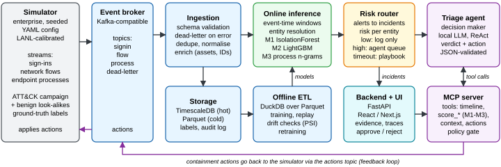

# ai4ci-agentic-soc

Agentic SOC for a simulated enterprise: correlates asynchronous sign-in, network-flow and endpoint event streams; a local-LLM triage agent orchestrates ML detectors over MCP and takes containment actions that feed back into the simulator. AI4CI course project.

RFC: [docs/rfc/0001-agentic-soc.pdf](docs/rfc/0001-agentic-soc.pdf) (source: [docs/rfc/0001-agentic-soc.md](docs/rfc/0001-agentic-soc.md))



## Components

| Component | Package | Status |
|-----------|---------|--------|
| Seeded enterprise simulator (sign-ins, flows, processes, ATT&CK campaign) | `agentic_soc.simulator` | done |
| Kafka-compatible event broker (Redpanda) | `agentic_soc.broker` | done |
| Ingestion: schema validation, dead-letter, dedupe, normalise, enrich | `agentic_soc.ingestion` | done |
| Storage: TimescaleDB (hot), Parquet (cold), labels, audit log | `agentic_soc.storage` | done |
| Offline ETL in DuckDB, drift checks (PSI/KS), retraining | `agentic_soc.etl`, `agentic_soc.drift` | done |
| Online inference: event-time windows, entity resolution, M1–M3 | `agentic_soc.features`, `agentic_soc.detectors` | done |
| Correlation engine, risk router and playbooks | `agentic_soc.correlation`, `agentic_soc.routing` | done |
| MCP server and policy gate | `agentic_soc.mcp_server`, `agentic_soc.actions` | done |
| Local-LLM triage agent (ReAct) | `agentic_soc.agent` | done |
| Closed-loop pipeline (in-process and live on the broker) | `agentic_soc.pipeline` | done |
| Evidence bundles behind every verdict, analyst feedback and FP statistics | `agentic_soc.evidence` | done |
| FastAPI backend (REST + server-sent events) and Next.js SOC console | `agentic_soc.api`, `web/` | done |
| Evaluation (model level, end to end, S1 drift, S2 load) | `agentic_soc.evaluation` | done |

## Development

Requirements: Python 3.12 and [uv](https://docs.astral.sh/uv/).

```bash
make install   # uv sync
make test      # fast unit tests
make lint      # ruff
uv run soc --help
```

On macOS, LightGBM needs OpenMP: `brew install libomp`.

## Running the SOC

```bash
uv run soc etl build          # simulate the dataset plan into data/ (lake + feature tables)
uv run soc train              # train M1-M3 into the model registry (models/)
uv run soc run                # closed loop: simulator + SOC in one process (scripted analyst)
uv run soc run --llm ollama:gpt-oss:20b          # the triage agent on a local LLM (Ollama)
uv run soc run --mode detectors                  # baseline: detectors + playbooks, no agent
```

Scenario S1 (drift) moves most staff to remote work through a newly adopted ZTNA service, so
sign-ins come from new networks abroad and later in the day. The drift monitor compares the
live M1 feature windows with M1's training distribution (PSI and KS) and alarms; with
`--retrain-on-drift` M1 is retrained offline on the recent sign-ins with refreshed baselines and
swapped in:

```bash
uv run soc run --scenario config/scenarios/s1-remote-work.yaml --hours 72 --retrain-on-drift
```

Scenario S2 (high load) adds a one-hour burst of user activity, about ten times the usual event
rate, on a working-day morning while the intrusion is under way. Streamed live through Redpanda
it shows consumer lag, end-to-end latency and the router shedding incidents to the playbooks
when the agent cannot keep up (`--scenario config/scenarios/s2-burst.yaml`).

`soc run` writes `data/soc-runs/<mode>-seed<seed>/` with the SOC store (`soc.db`), the run
summary, the pipeline log and the simulator's ground truth. The agent's latency is charged in
simulated time, so the attack keeps going while it investigates; high-impact actions are
auto-approved in these unattended runs (`--approval-delay` models an analyst's response time).

The console API (FastAPI) serves a recorded run read-only, or a live demo in which the
simulator, the pipeline and the API share one process and an analyst approves or rejects held
actions:

```bash
uv run soc api --run data/soc-runs/agent-seed201   # http://127.0.0.1:8000/api, read-only
uv run soc demo --speed 120                        # live: attack 1.5 h in, analyst approvals
```

The SOC console (`web/`, Next.js with Tabler icons and framer-motion) shows stream health,
the incident queue, incident timelines with the agent's tool trace and evidence, approvals,
analyst feedback, metrics with the drift monitor, the evaluation results and the audit log; see
[web/README.md](web/README.md):

```bash
cd web && npm install && npm run dev               # http://localhost:3000
```

A static replay of one recorded run (scenario S1 with retraining) is published on GitHub Pages
at https://chris91ss.github.io/ai4ci-agentic-soc/; `soc export` writes a run's data for it (see
[web/README.md](web/README.md#static-demo-github-pages)).

Endpoints: `/api/health`, `/api/stream-health`, `/api/incidents[/{id}[/evidence|/trace|/feedback]]`,
`/api/entities/{entity}[/timeline]`, `/api/actions[/{id}/approve|/reject]`, `/api/metrics`,
`/api/audit[/verify]`, `/api/evaluation` (the results in `docs/evaluation`) and `/api/events`
(server-sent events of the live pipeline).

Live mode streams through Redpanda instead (`make up` starts it and TimescaleDB):

```bash
uv run soc simulate --broker kafka://localhost:19092 --speed 60 --out data/runs/live
uv run soc pipeline --inventory data/runs/live/inventory.json --db $SOC_DB --api-port 8000
```

## Evaluation

`soc evaluate` runs the experiments of the RFC's evaluation plan and collects them in
[docs/evaluation](docs/evaluation/README.md) (`results.json` plus a Markdown report):

```bash
uv run soc evaluate models                    # M1-M3 on the held-out test weeks: PR-AUC, recall at 1% FPR, FP/day
uv run soc evaluate e2e --seeds 401-410       # agent vs detectors + playbooks vs rules, paired over seeds
uv run soc evaluate llm --seeds 401-403       # the agent on gpt-oss:20b through Ollama, same seeds
uv run soc evaluate s1 --seeds 301-303        # S1 drift, with and without retraining
uv run soc evaluate s2                        # S2 burst through Redpanda (make up): lag, latency, shedding
```

End-to-end runs are 48-hour closed loops on successive weeks; each reports the time to detect and
to contain (from the start of the intrusion), how far the attacker got, exfiltrated data, false
containments (executed actions on entities outside the attack) and the agent's verdict quality.
Paired Wilcoxon signed-rank tests compare the agent with each baseline on the same seeds.

## Results

Full tables and the raw numbers: [docs/evaluation](docs/evaluation/README.md) (also on the
console's Evaluation page).

**End to end (10 seeds, 48 h each, same attacks for every configuration).** Every configuration
stopped every intrusion before exfiltration, but at very different costs:

| | Agent (scripted analyst) | Detectors + playbooks | Rules + playbooks |
|---|---|---|---|
| Stopped before exfiltration | 10/10 | 10/10 | 10/10 |
| False containments (all runs) | **0** | 46 | 33 |
| Runs without a false containment | **10/10** | 1/10 | 0/10 |
| Time to contain, median | 16 min | 12 min | 15 min |
| Incidents per run (alerts → incidents) | 30 (−81%) | 31 (−83%) | 113 (−67%) |

The agent's 73 containment actions all hit the attacker (action correctness 1.00; verdict
precision 1.00, recall 0.68, F1 0.81 – the attack incidents it did not call malicious it left
"suspicious" for an analyst; no invalid tool calls). Compared on the same seeds (Wilcoxon), it
makes fewer false containments than the detectors' playbooks (median −3.5 per run, p = 0.004)
and the rules (−3.0, p = 0.002) and raises 83 fewer incidents per run than the rules (p = 0.002),
but contains about 3 minutes later than the playbooks (p = 0.002): it investigates before acting,
and its latency (about 2 minutes per triage) is charged in simulated time while the attack goes on.
In exchange the attacker usually got one kill-chain stage further (median +1 against both
baselines, not significant), typically to its C2 beacon, but was stopped before credential access
in 9 of 10 runs and before collection in all.

**Detectors (held-out test weeks).** PR-AUC 0.996 (M1 per account), 0.979 (M1 per source IP),
0.999 (M2 flows) and 0.749 (M3 process rarity); recall at 1% FPR of at least 0.99 for all four.

**S1, drift (3 seeds, 72 h).** When most staff move to remote work through a new ZTNA egress, the
drift monitor alarms 4 hours after the shift (M1's per-IP features, PSI above 1). False M1 alerts
jump from 0.5–0.7 per hour to about 14 per hour. Without retraining they stay at 8–10 per hour
the next day (7–12 times the pre-shift busy-hour rate) and never recover within the run; with
retraining (two retrains, 7 and 35 hours after the shift) they fall to 1.8–2.7 per hour, and M1
is back within twice its pre-shift rate by the next morning in 2 of 3 runs (25–30 h). The agent
checks where a suspicious sign-in came from before revoking sessions, so in neither configuration
did the look-alike sign-ins through the company's ZTNA egress lead to a false containment, and
every intrusion was stopped before exfiltration.

**S2, high load (Redpanda, 60× real time).** A one-hour burst raised the event rate 10.9-fold,
to about 3,000 events per second. The pipeline kept up: the p95 stream lag stayed at the
simulator's one-minute tick and the consumer lag peaked at about 3,200 messages, around one
second of input. With the local LLM four times slower during the burst, 4 of 15 triages timed
out, the circuit breaker opened once and the playbooks decided those incidents; the intrusion was
stopped before credential access in both runs.

