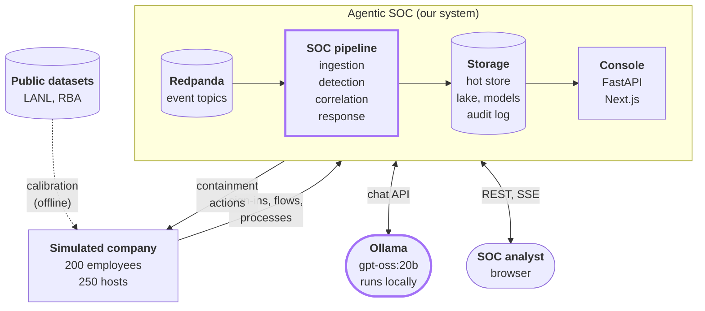
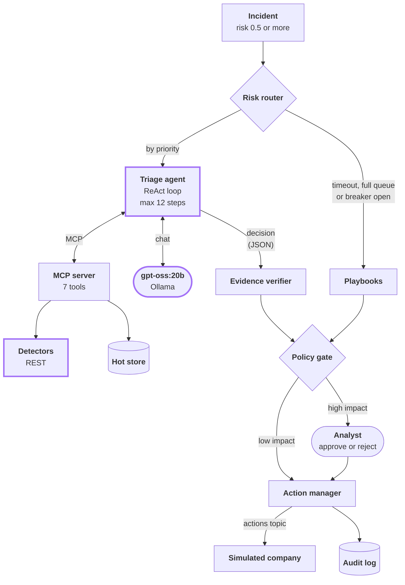
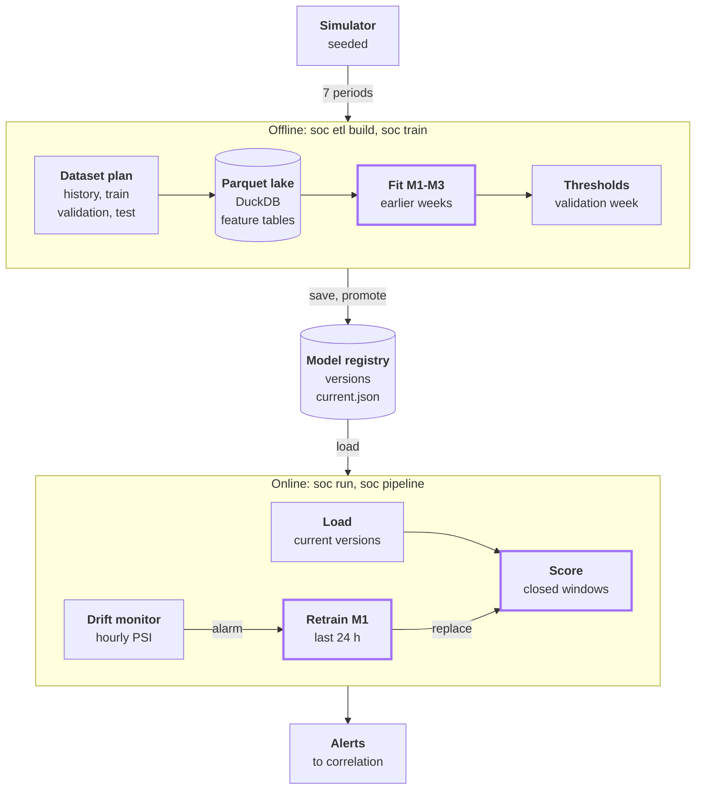
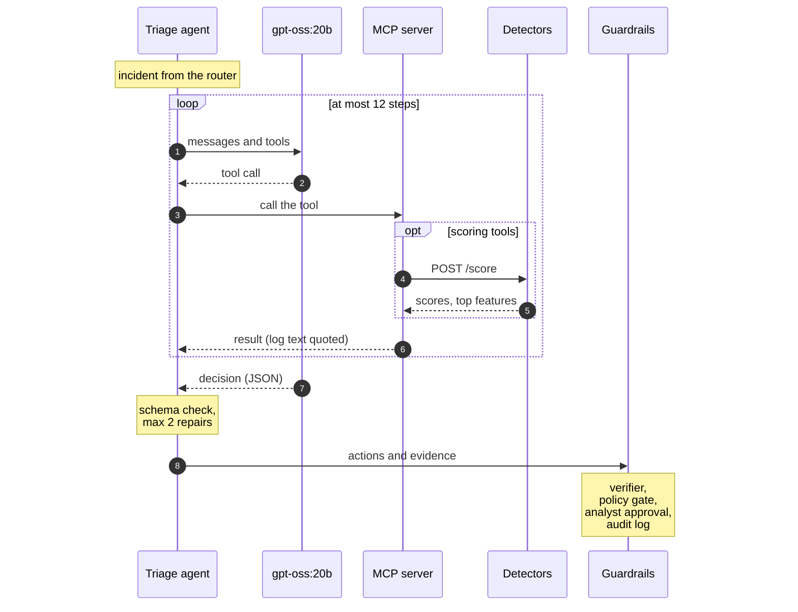

# Milestone 2: Architecture and implementation plan

**Authors:** Adi, Cristi, Dragos | **Course:** AI4CI | **Date:** November 2026

This document describes the architecture of Agentic SOC and our plan until the final presentation. It builds on our proposal, [RFC-0001](../rfc/0001-agentic-soc.md).

**Status.** We started implementing early, so most of the architecture described here already works end to end (see the commits from 13-15 November). A recorded run can be explored in the [live demo](https://chris91ss.github.io/ai4ci-agentic-soc/), and our first results are in [docs/evaluation](../evaluation/README.md). Because of this, the plan in section 7 is mostly about evaluating the system properly and finishing the parts that are still missing.

## 1. Problem and industrial context

A Security Operations Center (SOC) has to decide quickly whether small signals coming from different systems add up to an attack. In a company, sign-ins, network traffic and activity on the computers are logged by different tools, and an intrusion usually leaves only weak traces in each of them, minutes or hours apart. Analysts receive thousands of alerts per day, most of them false positives, so real attacks are often missed or found too late.

We build a SOC for a simulated company, Example Corp. It has 200 employees, each with a workstation, in two offices (Cluj-Napoca and Bucharest), and 50 servers: domain controllers, file, database and application servers, mail and backup servers, and a DMZ with web servers and the VPN gateway. A simulator generates the company's logs and hides one multi-step attack among the normal activity. Our system has to detect the attack, investigate it with an LLM agent and contain it. Containment actions are sent back to the simulator, so blocking the attacker really changes what happens next, and because the data is simulated we always know the ground truth.

### Stakeholders

- **SOC analysts** want fewer alerts and evidence they can check. They get incidents instead of raw alerts, together with the agent's investigation, and they approve or reject risky actions.
- **Incident responders and the SOC lead** want the attack contained before any data is stolen, and a record of what was done and why (the audit log).
- **Employees and IT** should not be locked out by mistake. False containments are our main cost metric, and high-impact actions need an analyst's approval.
- **ML engineers** need to know when a model stops working, so we have a drift monitor and versioned models that can be rolled back.
- **Management and compliance** care about where the data goes. The LLM runs locally, so log data never leaves the company.

### Decisions the system supports

1. Is the activity in this time window anomalous? (detectors M1, M2 and M3)
2. Which alerts belong to the same incident, and how risky is it? (correlation)
3. Should the agent investigate the incident now? (risk router)
4. Is it really an attack, and what should be contained? (triage agent)
5. Is the proposed action allowed to run? (evidence verifier, policy gate, analyst)
6. Is model M1 still valid? (drift monitor)

## 2. Data sources

All the data processed by the system comes from our simulator. Public datasets are used only offline, to make the simulator realistic.

| Stream (topic) | Produced by | Main fields | Volume in a 48 h run |
| --- | --- | --- | --- |
| Sign-ins (`signin`) | identity provider: VPN, SSO, Windows logons | user, source IP, application, logon type, result, MFA, user agent, device, country | about 10k (200 per hour, up to 600) |
| Network flows (`flow`) | firewall and flow sensors | source and destination IP and port, protocol, duration, bytes and packets in each direction, firewall action | about 280k (5,800 per hour, up to 13,000) |
| Processes (`process`) | EDR agent on each host | host, user, process and parent process, command line, path, integrity level | about 125k (2,600 per hour, up to 6,900) |

Activity follows working hours and weekdays, while servers stay busy at night with backups and batch jobs. The streams are not clean: events arrive with a delay (a median of 2 s for sign-ins, 15 s for flows and 4 s for processes), a few arrive up to an hour late, some are duplicated, some producers have clock skew, and a small fraction of messages is malformed. Some older producers still use version 0.9 of the sign-in and flow schemas. All schemas are in [docs/schemas](../schemas).

Other data:

- **Inventory:** users with their roles and privileges, hosts with their role, network zone and criticality, the office IP ranges, DHCP and VPN leases, and GeoIP information.
- **Ground truth:** the simulator labels every attack event with its stage and its ATT&CK technique. We use the labels to train M2 and to evaluate the system. The agent never sees them.
- **Public datasets:** the [LANL multi-source dataset](https://csr.lanl.gov/data/cyber1/) and the [RBA login dataset](https://doi.org/10.5281/zenodo.6782156). The `soc calibrate` command fits the simulator's activity profiles and distributions on them. For now the simulator uses hand-set values with the same shape; fitting them on the real files is planned for weeks 9 and 10.
- **Analyst feedback:** verdicts entered in the console (true or false positive), used for false-positive statistics per detector and for retraining.

How new data enters the system:

1. The simulator runs in one-minute steps and generates events with their event time.
2. Each event gets an arrival time (with delays, duplicates and clock skew) and is published to its topic on Redpanda, a Kafka-compatible broker.
3. Ingestion checks each event against its schema and sends invalid ones to a dead-letter topic. It removes duplicates, normalises user and host names, adds information from the inventory and writes the event to the hot store.
4. The event is added to a window of 10 or 15 minutes for its account, IP address or host. Windows are based on event time and close when the watermark passes their end; a late event reopens its window.
5. In live mode the simulator publishes to Redpanda in accelerated real time. For the evaluation we run the same pipeline in simulated time, which is much faster and gives the same result for the same seed.

## 3. System architecture

The AI components are marked in purple in all the diagrams.

*Figure 1. Our system and what it interacts with.*

The system we build contains the broker, the SOC pipeline, the storage and the console. The simulated company, the analyst, Ollama and the public datasets are outside of it. In a real company the identity provider, the firewall and the EDR would publish to the same topics, and the rest of the pipeline would stay the same. We also treat the log data as untrusted: fields like command lines and user agents can be controlled by an attacker, so the LLM only receives them as quoted data.

*Figure 2. Detection: from the event topics to incidents.*

After ingestion, every closed window becomes a feature row for one of the detectors. If its score passes the detector's threshold, it becomes an alert with the most important features and the matching ATT&CK techniques. The correlation engine groups alerts that share a user, host or IP address within 6 hours into incidents. The risk of an incident depends on how strong its alerts are, how many detectors agree, how far the attack has progressed and how critical the affected hosts and accounts are.

*Figure 3. Response: from an incident to containment.*

Incidents with a risk below 0.5 are only logged. The others wait in the agent's queue, ordered by priority. The agent can only read data and act through the tools of the MCP server. Its actions go through the evidence verifier and the policy gate, and the playbooks' actions go through the policy gate as well. Low-impact actions (revoking sessions, blocking an external IP) run immediately, while high-impact ones (disabling an account, isolating a host) wait for an analyst. Executed actions are published on the `actions` topic, and the simulator applies them. Every step is written to an audit log protected by a hash chain.

**Interfaces.**

- Event topics (`signin`, `flow`, `process`) and the `actions` topic on Redpanda, with JSON messages and versioned schemas.
- Detector service: REST, `POST /score/M1` (and M2, M3).
- MCP server with 7 tools for the agent: `get_incident`, `get_entity_timeline`, `get_asset_context`, `score_signins`, `score_flows`, `score_processes` and `propose_action`.
- LLM: Ollama's chat API with tool calling. The final decision has to match a JSON schema.
- Console: a FastAPI backend (REST and server-sent events) and a Next.js frontend.

**Storage.**

- Hot store: TimescaleDB (SQLite in tests and recorded runs) for events, alerts, incidents, decisions, actions, evidence and the audit log.
- Lake: Parquet files queried with DuckDB, used for training data and replays.
- Model registry: one folder per model version and a pointer to the version in use.

Everything runs on a single laptop: Redpanda and TimescaleDB in Docker, the pipeline and the API in Python, the LLM in Ollama and the console in a browser.

**Main design decisions.**

- *A simulator instead of a fixed dataset.* Containment has to change what the attacker does next, which is impossible with recorded data, and we get the ground truth for free.
- *A broker and event-time windows.* Like in a real SOC, the streams arrive late and out of order, and the results should not depend on the order of arrival.
- *One small model per stream.* The streams have different meanings and rates (about 27 flows for every sign-in), and small models are fast, easy to explain and can be retrained separately.
- *Correlation before the LLM.* The LLM needs a few seconds per step, so instead of about 180 alerts per run it only gets the risky incidents (out of about 30).
- *A local LLM.* Security logs contain personal data that should not leave the company. A local model also has no cost per call, and its version does not change between experiments.
- *Deterministic guardrails.* LLM agents can be manipulated through prompt injection and can invent evidence, so the final checks are normal code that we can test.

## 4. AI decision takers

### M1: sign-in anomalies (Isolation Forest)

- **Input:** a 15-minute window of one account's sign-ins, described by 25 features, most of them compared with the account's usual behaviour (new country, new device, unusual hour, failed attempts, legacy authentication). A second model looks at each external IP address, with 16 features (how many accounts it tried, unknown usernames, hosting or anonymiser networks).
- **Output:** an anomaly score. An alert is raised above a threshold chosen for 0.2% false positives per account and 0.5% per IP address on the validation data.
- **Why:** account misuse comes without reliable labels and the next attack will look different, so an unsupervised model fits. Password spraying is hard to see for a single account (one failed attempt each) but obvious from the source IP, which is why we have the second model.

### M2: network flows (LightGBM)

- **Input:** the flows of one source IP over 15 minutes, one row for each destination and port, with 47 features: traffic volume, ports, direction, type of destination, time of day, and beaconing features (for example how regular the connections to a destination are).
- **Output:** the probability that the traffic belongs to the attack, with the contribution of each feature as an explanation.
- **Why:** for flows we do have labelled attack traffic from the training weeks. The data is tabular and very imbalanced, and gradient boosting handles that well, is fast and is easy to explain.

### M3: process rarity (n-grams)

- **Input:** the processes started on one host over 10 minutes, as parent-child pairs (for example `cmd.exe` starting `whoami.exe`). For each pair, the model checks how rare it is on similar hosts: workstations of the same role, or servers with the same function.
- **Output:** a rarity score and an alert, explained by its rarest pairs and by how many similar hosts run them on a normal day.
- **Why:** attacker tools are rare for a given kind of host, analysts can understand the explanation, and no labels are needed. In the plan we compare M3 with a DeepLog-style LSTM, the stretch goal of the RFC.

### Triage agent (gpt-oss:20b)

- **Input:** the incident ID with its risk, and then whatever the agent requests through the tools: incident details, the timeline of a user, host or IP, asset context and detector scores. Text that comes from the logs is marked as untrusted.
- **Output:** a decision that must match a JSON schema: a verdict (malicious, suspicious or benign), ATT&CK techniques, the IDs of the evidence it relied on, up to three containment actions, a confidence and a short explanation. The agent has at most 12 steps per incident.
- **Why:** like an analyst, it can combine evidence from all three streams and decide what to look at for each incident. gpt-oss:20b is a mixture-of-experts model (21B parameters, about 3.6B active per token) that runs on a laptop. We don't fine-tune it, because there are no labelled triage examples to train on.

For the experiments with many runs we also use a "scripted analyst": a rule-based stand-in for the LLM that uses the same tools and returns decisions in the same format. It is fast and deterministic, so we can run 10 seeds of every configuration.

The AI components are surrounded by deterministic ones:

- **Risk router:** incidents below risk 0.5 are only logged; the others are queued for the agent (at most 25). If the agent doesn't answer within 3 minutes, a playbook decides instead, and after 3 failures in a row a circuit breaker sends all incidents to the playbooks for 15 minutes.
- **Playbooks:** fixed SOAR-style rules, for example "beaconing to an external IP: block the IP and isolate the host". They are used when the agent is not available, and in the baselines.
- **Evidence verifier (optional):** rejects an action if the alerts the agent cited don't justify it. For example, an IP address is only blocked if the cited alerts show that it sprayed passwords, used a stolen account or was the attacker's C2 server.
- **Policy gate:** a list of allowed actions, protected servers and addresses that can't be blocked automatically, and limits (6 actions per incident, 12 automatic actions per hour).
- **Drift monitor:** every hour it compares M1's features from the last 24 hours with the training data (PSI). If two features are above 0.25 in two checks in a row, it raises an alarm.

## 5. Training and inference

*Figure 4. Training happens offline; the pipeline loads the models from the registry.*

**Where training happens.** All detectors are trained offline on a laptop CPU, no GPU needed. `soc etl build` simulates seven periods into a Parquet lake and builds the feature tables with DuckDB, which takes about 7 minutes. `soc train` then trains M1, M2 and M3. The periods are split in time so that no model learns from the future: one week of normal activity (for the baselines and the unsupervised models), three 48-hour periods with an attack (to train M2), one validation period (for the thresholds) and two test periods (for the model-level metrics).

**How models are stored and loaded.** Each training run saves a new version in `models/<detector>/<version>/`: the model itself (the Isolation Forests, the LightGBM model or the n-gram counts) and a `meta.json` file with the thresholds and validation results. A `current.json` file points to the version in use, and `soc models --promote` can switch back to an older one. The pipeline and the detector service load the current versions when they start. Models and data are not committed to Git, since they can be rebuilt from the seeds.

**During operation.** Every closed window is scored, and becomes an alert if it passes the threshold. The agent can also run the detectors on any user, host or IP through its scoring tools. When the drift monitor raises an alarm and retraining is enabled, M1 is retrained 3 hours later on the last 24 hours of sign-ins, leaving out events from confirmed attacks, and the new model replaces the running one. At the moment the retrained model only exists in the running pipeline and its log; saving it to the registry is planned for week 9.

**The LLM.** We don't train it. It is downloaded with `ollama pull gpt-oss:20b` and runs locally with a temperature of 0.1 and a 16k context. The prompt, the tool definitions and the decision schema are in [agent/prompts.py](../../src/agentic_soc/agent/prompts.py).

*Figure 5. One triage.* If a tool call is invalid, the agent gets the error back and can try again. If the final decision doesn't match the schema or cites IDs that no tool returned, it gets at most two attempts to fix it.

## 6. Evaluation

All results are in [docs/evaluation](../evaluation/README.md). The numbers below were measured on 14 November. We will re-run all experiments this week (see the plan).

**Baselines.**

- *Rules + playbooks:* 12 SIEM-style rules (password spraying, brute force, LSASS dumps, PsExec, large uploads and others), the same correlation, and the playbooks decide.
- *Detectors + playbooks:* M1-M3 and the same correlation, but without the agent.

We compare both with our system, with and without the evidence verifier.

**Evaluation data.**

- Model level: two held-out test periods, 4 days in total.
- End to end: 10 simulated 48-hour runs (seeds 401-410), each with a different attack timing. All configurations use the same seeds, so we can compare them in pairs with a Wilcoxon signed-rank test. So far the agent was the scripted analyst on all 10 seeds and gpt-oss:20b on 3 of them. There is no analyst in these runs, so high-impact actions are approved automatically.
- S1, drift: 3 runs of 72 hours in which most employees switch to working from home on the second day.
- S2, load: a run through Redpanda with 10 times the normal event rate for one hour during the attack, once with the normal LLM speed and once with an LLM 4 times slower.

**Expected outputs.** For each incident: the verdict, the cited evidence, the actions and the agent's full trace. For each run: a summary, the pipeline log and the ground truth of the attack. For each experiment: a JSON file with the results and the report.

**Metrics and first results.**

| Level | Metrics | Results so far |
| --- | --- | --- |
| Detectors | PR-AUC, recall at 1% false positives, false positives per day, detection delay | PR-AUC 0.996 (M1 per account), 0.979 (M1 per IP), 0.999 (M2), 0.749 (M3) |
| Agent | verdict precision and recall, correct actions, invalid tool calls, latency | scripted analyst: precision 1.0, recall 0.68; gpt-oss:20b: precision 0.57, recall 0.80, 18% invalid tool calls |
| End to end | attacks stopped before exfiltration, time to detect and to contain, false containments, alert reduction | all three configurations stopped 10 of 10 attacks; 0 false containments for the agent against 46 and 33 for the baselines; 81% fewer items for the analysts |
| S1 (drift) | time to the alarm, false alerts per hour, with and without retraining | alarm after 4 hours; false alerts went from under 1 to about 14 per hour, then back to about 2 with retraining (8 to 10 without) |
| S2 (load) | stream lag, agent timeouts, circuit breaker | stream lag stayed at about one minute; with the slower LLM, 4 of 15 triages timed out, the playbooks took over and the attack was still stopped |

The agent made significantly fewer false containments than both baselines (p = 0.004 and p = 0.002), but it contained the attack about 3 minutes later than the detectors with playbooks.

**Failure scenarios.**

- **Prompt injection.** The attacker hides instructions for "AI analysts" in command lines and user agents. Log text reaches the LLM only as quoted data, decisions have to cite evidence, and the gate and verifier are normal code. The injection is part of every simulated attack, and a planned ablation removes the quoting to see how often it succeeds.
- **The LLM is slow or down.** Timeouts, the queue limit and the circuit breaker hand incidents to the playbooks (tested in S2).
- **Benign drift.** In S1 the move to remote work makes M1 raise many false alerts, and employees now connect through a new cloud (ZTNA) address. The drift monitor and retraining reduce the false alerts. Blocking that address would cut off the whole company, so the agent only blocks addresses from hosting or anonymiser networks, and the evidence verifier refuses cloud and office addresses. There were no false containments in S1.
- **False containment.** An innocent user or host could be blocked. High-impact actions need an analyst, and we count false containments in every run (0 for the scripted analyst, 2 for gpt-oss:20b in 3 runs, 1 with the verifier).
- **Invented evidence and invalid tool calls.** They are rejected and the agent has to fix them. We report the rate of invalid tool calls (18% for gpt-oss:20b).

## 7. Implementation plan

**Already done (13-15 November):** the simulator, broker and ingestion, storage, features, the three detectors with the model registry, correlation, the router and playbooks, the policy gate, the MCP server and the agent, the evidence verifier, the drift monitor with M1 retraining, the rules baseline, the console with the live demo, and the evaluation scripts with the first results. CI runs 182 unit tests on every push.

**Plan until the final presentation (week 14):**

| Week | Dates | Work | Result |
| --- | --- | --- | --- |
| 8 | 16‑22 Nov | Milestone 2 document. Re-run all experiments after the determinism fix from 15 November | Updated evaluation report |
| 9 | 23‑29 Nov | Milestone 1 feedback. Fit the simulator on the real LANL and RBA data. Save retrained models in the registry | Fitted calibration, compared with the current one |
| 10 | 30 Nov‑6 Dec | Rebuild the data, retrain M1-M3 and re-run the evaluation with the new calibration | Results for both calibrations |
| 11 | 7‑13 Dec | gpt-oss:20b on all 10 seeds, with and without the verifier. Start a second attack campaign (different initial access, C2 and exfiltration) | LLM results with significance tests; the second campaign in the simulator |
| 12 | 14‑20 Dec | Test the system on the second campaign without changing the detectors. Compare Qwen3 with gpt-oss:20b | Generalisation and model comparison |
| Break | 21‑27 Dec | Ablations: no quoting, no verifier, no scoring tools | Ablation results |
| Break | 28 Dec‑3 Jan | DeepLog-style LSTM compared with M3 | DeepLog results |
| 13 | 4‑10 Jan | Final report, slides and a demo video | Report and slides |
| 14 | 11‑17 Jan | Final presentation | |

By the progress review on 31 December we expect to have finished everything up to the ablations, with DeepLog still in progress.

**Risks.**

- The LANL files are large (about 10 GB compressed). If needed we fit the calibration on a sample of days, and the current values stay as a fallback.
- One LLM run takes 12-25 minutes and the plan needs about 60 runs, so we will run them overnight.
- Qwen3-30B-A3B needs about 19 GB of memory, which may be too much on a laptop with 24 GB. In that case we use Qwen3-14B.
- The second campaign could turn out too easy or too hard. We will fix its design before measuring anything and report the results either way.

## 8. Changes to this plan

We will write down here any significant change to this plan, with the reason. No changes so far.
