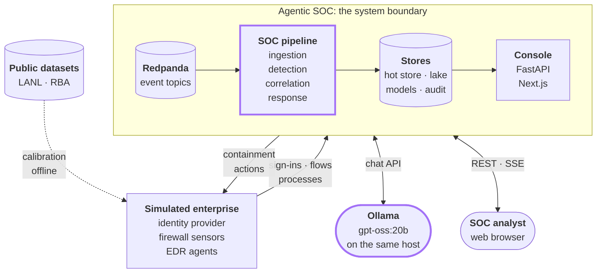
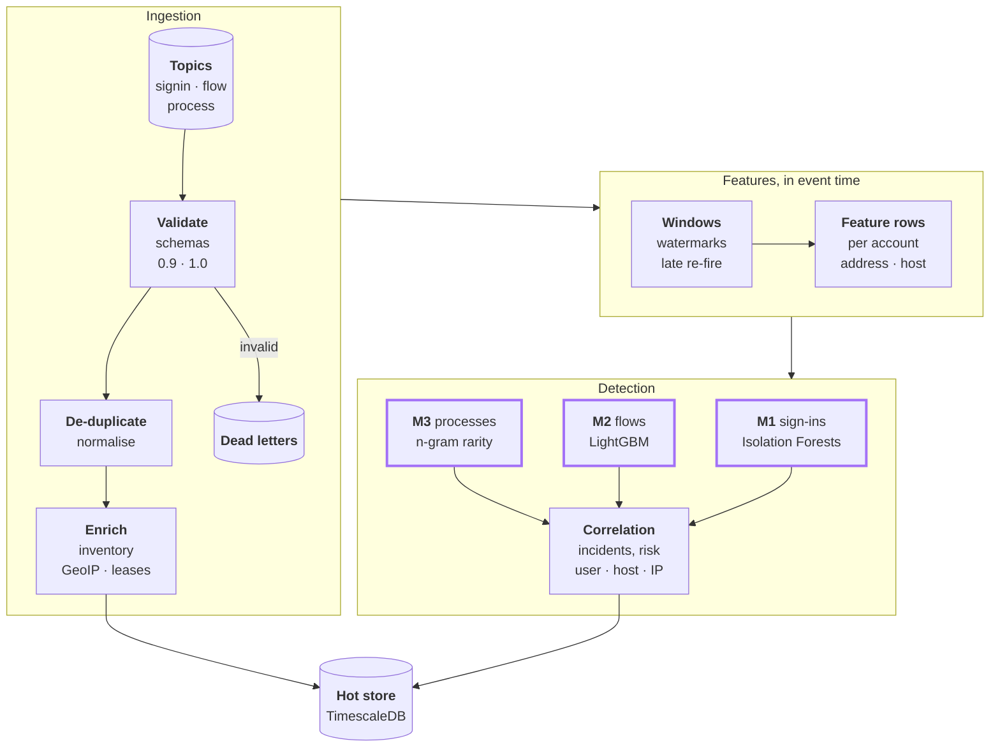
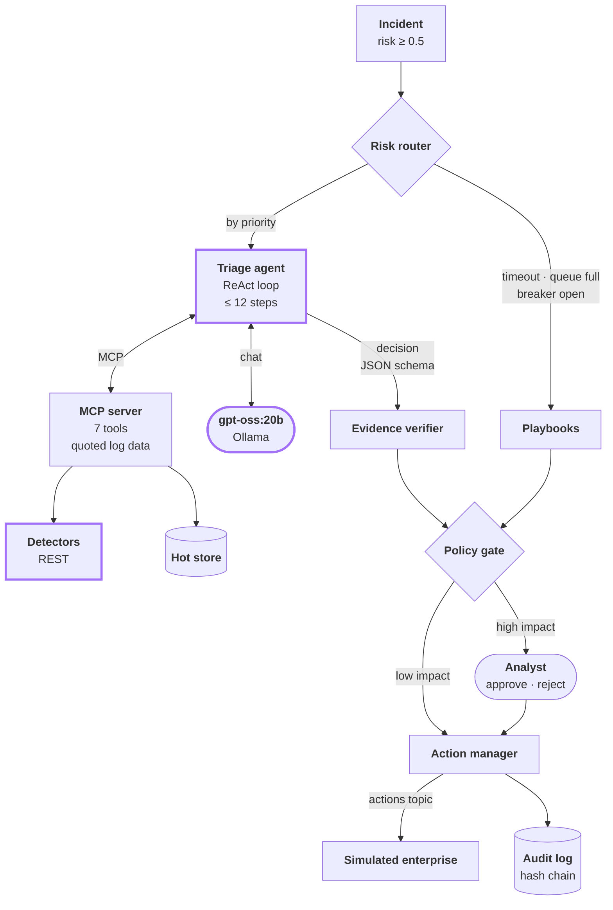
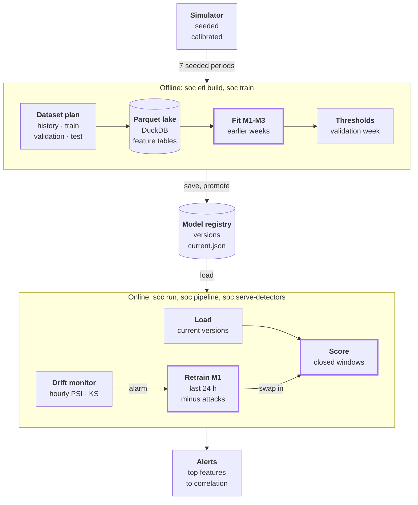
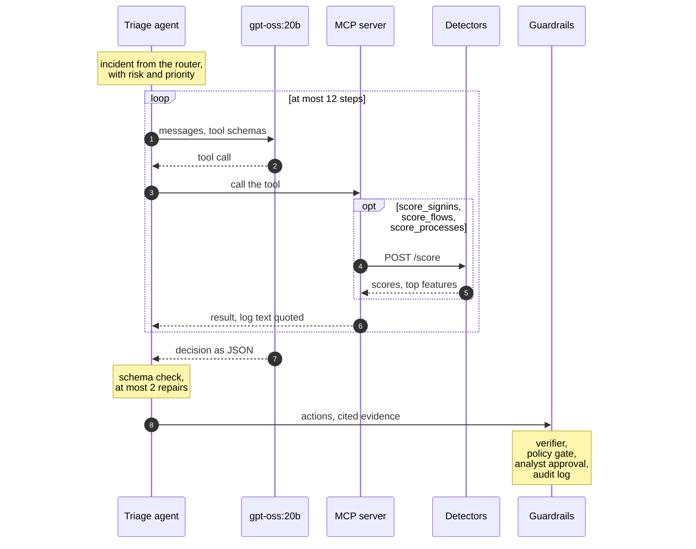
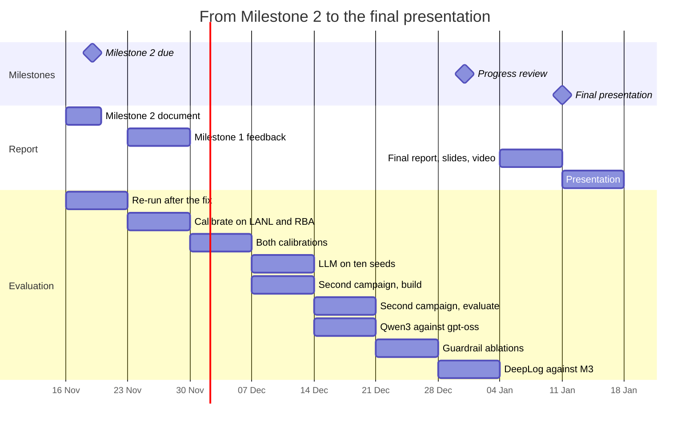

# Milestone 2: architecture and implementation plan

**Agentic SOC for a simulated enterprise** · Adi, Cristi, Dragos · AI4CI · 19 November 2026

The proposal is [RFC-0001](../rfc/0001-agentic-soc.md) (Milestone 1). This document covers Milestone 2: the system's architecture and the reasons for it, its data and AI modules, how models are trained and used, how the system is evaluated, and the plan up to the final presentation in week 14 (11–17 January 2027).

> [!NOTE]
> **Where the project stands.** The architecture below is implemented and runs end to end. The code is in this repository (commits of 13–15 November), CI runs the 182 unit tests and builds the console on every push, a recorded run is [live on GitHub Pages](https://chris91ss.github.io/ai4ci-agentic-soc/), and the first results are in [docs/evaluation](../evaluation/README.md). The plan in [section 7](#7-implementation-plan) covers what is left: re-running the evaluation, calibrating on real data, a second attack campaign, more seeds and a second model for the LLM, ablations, and the final report.

**Contents:** [1. Problem and industrial context](#1-problem-and-industrial-context) · [2. Data sources](#2-data-sources) · [3. System architecture](#3-system-architecture) · [4. AI decision takers](#4-ai-decision-takers) · [5. Training and inference](#5-training-and-inference) · [6. Evaluation](#6-evaluation) · [7. Implementation plan](#7-implementation-plan) · [8. Changes to this plan](#8-changes-to-this-plan)

## 1. Problem and industrial context

A security operations centre (SOC) protects a company whose identity provider, network and endpoints are connected systems, run by different teams and logged separately: who signs in from where, which hosts exchange how much data, and what runs on each host. An intrusion leaves weak traces in all three, minutes or hours apart, and rarely a conclusive one in any. Analysts receive thousands of alerts a day and ignore most of them, and breaches still take months to identify and contain ([RFC §1](../rfc/0001-agentic-soc.md#1-project-description)). The decision that matters is made per incident: is this an attack, and what should be contained now, without locking out the business?

The company is simulated. Example Corp has 200 employees, each with a workstation, in two offices in Cluj-Napoca and Bucharest, and 50 servers: domain controllers, file, database, application, ERP, mail, backup, build and jump hosts, and a DMZ with web servers, proxies and the VPN gateway. Staff sign in to the VPN and to SaaS applications through single sign-on. A seeded simulator stands in for the company: it emits its telemetry, hides one ATT&CK-mapped intrusion among benign activity, and applies the SOC's containment. A decision therefore has consequences (the attacker pivots or stalls), and every result has ground truth.

### Stakeholders

| Stakeholder | What they need | What the system gives them |
| --- | --- | --- |
| SOC analysts (tier 1 and 2) | Fewer, better-founded alerts, and evidence they can check | Incidents instead of alerts (81% fewer), each with the agent's verdict, its investigation and the evidence it cited; approve or reject high-impact actions; label verdicts |
| Incident responders, SOC lead | Containment before data leaves, and a record of what was done and why | Containment within minutes of detection; a hash-chained audit log of every decision, proposal, approval and execution |
| Employees and IT operations | Not to be locked out by mistake | False containment is the main cost metric; high-impact actions wait for an analyst; only an analyst may isolate core servers, and office and major providers' addresses cannot be blocked |
| Detection and ML engineers | To know when a model degrades, and to roll back | A drift monitor with alarms and retraining; a versioned model registry with promotion and rollback |
| CISO and compliance | Lower risk, without sending telemetry to third parties | A local LLM, so no log data leaves the company; every action traceable to its evidence |

### Decisions the system supports

1. **Is this window of activity anomalous?** Detectors M1–M3 score each entity's window of events, thousands an hour, and raise alerts.
2. **Which alerts belong together, and how risky are they?** Correlation links alerts by user, host and address into incidents with a risk score.
3. **Does this incident need investigating now?** The risk router logs it, queues it for the agent by priority, or hands it to a playbook when the agent is slow or down.
4. **Is it an attack, and what should be contained?** The triage agent returns a verdict, ATT&CK techniques, the evidence it relied on and up to three containment actions: revoke sessions, disable an account, isolate a host or block an address.
5. **May this action run?** The evidence verifier, the policy gate and, for high-impact actions, an analyst decide whether it executes, waits or is refused.
6. **Is M1 still valid?** The drift monitor raises an alarm and M1 is retrained.

The goal, set in the RFC, is to stop the intrusion before exfiltration with as few false containments as possible, and to show it end to end against a rule-based SOC and against detectors with playbooks.

## 2. Data sources

All operational data comes from the simulator, shaped like the telemetry a real SOC collects. Public datasets are used only offline, to calibrate it.

### Event streams

Volumes are from a 48-hour run (seed 201): the average an hour, and the busiest hour.

| Stream, topic | Produced by | One event is | Main fields | Volume per 48 h | Delivery |
| --- | --- | --- | --- | --- | --- |
| Sign-ins, `signin` | Identity provider: VPN, single sign-on, Windows logons | An authentication attempt | user, source address, application, destination host, logon type, protocol, outcome and failure reason, MFA, user agent, device, country and city, assigned VPN address | 10.4 thousand: 216 an hour, 610 at peak | Median delay 2 s; 1% late by 1–10 min; 0.3% duplicated; 35% of VPN sign-ins from an old appliance on schema 0.9 |
| Network flows, `flow` | Firewall and flow sensors | A connection record | source and destination address and port, protocol, duration, bytes and packets each way, firewall action, sensor | 281 thousand: 5,850 an hour, 13,300 at peak | Median 15 s; 2% late by 2–15 min; 1% duplicated; one sensor on schema 0.9 |
| Endpoint processes, `process` | EDR agents on the 250 hosts | A process launch | host, user, process and parent name, command line, image path, integrity level, pid and ppid | 125 thousand: 2,600 an hour, 6,900 at peak | Median 4 s; 3% late by 5–60 min; 0.5% duplicated; 3% of agents' clocks off by 30 s to 3 min |

Activity follows the working day and week: employees' activity at night is a few percent of its daytime peak and weekends carry about a fifth of a weekday's, while servers stay busy at night with batch jobs and backups; flow sizes are heavy-tailed. Malformed payloads, 0.03–0.05% of each stream or about 150 a run, go to a dead-letter topic. The JSON Schemas of every event version are in [docs/schemas](../schemas), generated from the Pydantic models with `soc schemas`.

### Context, labels and public data

- **Inventory**, slowly changing: 200 users with role, department, office and privileges, service accounts; 250 hosts with role, zone (corporate, data centre, DMZ), operating system and criticality 1–5; office egress netblocks; DHCP and VPN leases, which say which address a host or person had at a given time; GeoIP and network categories (ISP, hosting, anonymiser, cloud, CDN).
- **Ground truth**: the simulator labels every malicious event with its campaign stage and ATT&CK technique, and records the campaign's progress (stages reached, pivots, bytes exfiltrated, why it stalled) in each run's `truth.json`. Labels train M2 and score the evaluation; the agent never sees them.
- **Public datasets**, offline only and not redistributed: the [LANL multi-source events](https://csr.lanl.gov/data/cyber1/) (authentication, process and flow records) and the [RBA login dataset](https://doi.org/10.5281/zenodo.6782156). `soc calibrate` fits hourly and weekly activity profiles, flow size and duration distributions, and failure and new-country rates from them into [config/calibration](../../config/calibration). The current default is a hand-set prior shaped like LANL; fitting it on the real files is planned for weeks 9–10.
- **Analyst feedback**: verdicts entered in the console label the incident's alerts as true, false or benign positives.

### How new data enters the system

1. The simulator advances in 60-second ticks of simulated time. Each generator emits events with their event time, at rates that follow the calibrated daily and weekly profiles; the campaign's steps are interleaved with benign look-alikes (typos, travel, consumer VPNs, admin maintenance, nightly backups).
2. A delivery model gives each event an arrival time (a log-normal delay, stragglers, duplicates, producer clock skew), corrupts a few, and publishes them to their stream's topic, keyed by user, source address or host.
3. The ingestion consumer validates each payload against its schema version, sends failures to the dead-letter topic with an error code, upgrades 0.9 payloads, drops duplicates by event ID, normalises user and host names, and enriches the event from the inventory (person, role, zone, criticality, GeoIP, lease) before writing it to the hot store.
4. The feature pipeline puts each event into its event-time window: 15 minutes per account and per external source address for sign-ins, 15 minutes per source address for flows, and 10 minutes per host for processes. A window closes when the watermark, the latest arrival time minus 60 s (90 s for processes), passes its end. A late event re-opens its window and fires it again, for up to two hours.
5. In live mode the simulator publishes through Redpanda at a chosen speed, 60 or 120 times real time. Evaluation runs replay the same streams in process, in virtual time, faster than real time and deterministic under the seed.

## 3. System architecture

AI modules have a purple border in every figure.

### 3.1 Context and system boundary

*Figure 1. What we build and what it talks to.*

Inside the boundary is everything the project deploys: the broker, the SOC pipeline (ingestion, detection, correlation and response), the stores and the console. Outside are the simulated enterprise, the LLM runtime, the analyst and the public datasets. In a real deployment the company's identity provider, firewall and EDR would publish to the same topics and consume the `actions` topic, and nothing inside the boundary would change. Ollama runs on the same machine with open weights, so no telemetry leaves it. A second boundary runs through the data itself: every field that comes from the enterprise may be controlled by the attacker, and reaches the LLM only quoted as untrusted data.

### 3.2 Detection path

*Figure 2. From the topics to scored incidents.*

Ingestion turns three differently shaped, late and partly duplicated streams into clean, enriched events in the hot store. Entity resolution links the identifiers each stream uses for the same thing: an address is a host's DHCP or VPN lease at that moment, and an account is a person. Each closed window becomes a feature row for its detector, which scores it against a threshold and turns it into an alert with its top features and ATT&CK techniques. Correlation links alerts that share a user, host or address within six hours into incidents, and scores each incident from the strength of its evidence, how many independent detectors agree, how far along the kill chain it is, and what is at stake.

### 3.3 Response path

*Figure 3. From an incident to containment in the simulated enterprise.*

Incidents below risk 0.5 are only logged. The others wait in the agent's queue by priority, and are triaged again when their risk rises by 0.15 or a new tactic appears. The agent investigates through the MCP server only: it chooses which context and timelines to read and which detectors to run on which entity, then returns a decision. Its actions pass the evidence verifier (when enabled) and the policy gate, and so do the playbooks' actions. The action manager publishes executed actions on the `actions` topic, where the simulator applies them: a blocked address stops reaching the company, a revoked session must sign in again, a disabled account cannot, and an isolated host stops emitting flows. Every step is written to the hash-chained audit log, and every verdict is stored with the events, scores, baselines and tool calls behind it.

### 3.4 Interfaces

| Interface | Between | Protocol | Contract |
| --- | --- | --- | --- |
| `signin`, `flow`, `process` topics | simulator → ingestion | Kafka (Redpanda), JSON, keyed by user, source address or host | [Event schemas](../schemas): sign-in and flow 0.9 and 1.0, process 1.0 |
| Dead-letter topic | ingestion → operators | Kafka | Raw payload, error code and detail |
| `actions` topic | action manager → simulator | Kafka, JSON | [action.schema.json](../schemas/action.schema.json) |
| Detector service | pipeline and MCP tools → M1–M3 | REST: `POST /score/{M1,M2,M3}`, `GET /models` | Feature rows in; scores, thresholds and top features out |
| MCP server | agent → SOC tools | MCP, in process; stdio or streamable HTTP with `soc mcp` | 7 tools with JSON results; log text wrapped as `{"$untrusted": ...}` |
| LLM | agent → Ollama | HTTP `/api/chat` with tool calls | Decisions validated against [decision.schema.json](../schemas/decision.schema.json) |
| Console API | console → backend | REST and server-sent events | The `/api/...` endpoints listed in the [README](../../README.md#running-it) |

### 3.5 Storage

| Store | Technology | Holds | Written by | Read by |
| --- | --- | --- | --- | --- |
| Hot store | TimescaleDB; SQLite for tests and recorded runs | Normalised events, dead letters, alerts, incidents, decisions, tool calls, evidence, actions, feedback, audit log | Ingestion, pipeline, console API | MCP tools, console API, evaluation |
| Lake | Parquet, queried with DuckDB | The simulated weeks of the dataset plan, feature tables | `soc etl build`, `soc ingest --lake` | Training, analytics, deterministic replays |
| Model registry | Files: `models/<detector>/<version>/` and `current.json` | Fitted models, thresholds, validation results, drift references | `soc train`, `soc models --promote` | Pipeline, detector service |
| Run directory | `data/soc-runs/<run>/` | The run's store, summary, pipeline log and ground truth | `soc run` | Evaluation, console replay, `soc export` |

### 3.6 Deployment

Everything runs on one laptop; Docker is needed only for the live stack.

| Process | Started with | Port |
| --- | --- | --- |
| Redpanda and TimescaleDB | `make up` (Docker Compose) | 19092, 15432 |
| Simulator | `soc simulate --broker kafka://localhost:19092` | – |
| SOC pipeline with the console API | `soc pipeline --api-port 8000` | 8000 |
| Detector service (optional) | `soc serve-detectors` | 8001 |
| MCP server for other clients (optional) | `soc mcp --http` | 8002 |
| Ollama | `ollama serve` | 11434 |
| Console | `npm run dev`, or the static export on GitHub Pages | 3000 |

`soc demo` runs the simulator, the pipeline and the API in one process, and `soc run` runs a whole closed loop in virtual time for the evaluation.

### 3.7 Design decisions

| Decision | Instead of | Why |
| --- | --- | --- |
| A seeded simulator of the company | Recorded datasets only (LANL, CIC-IDS) | Containment must change what the attacker does next, which a recording cannot do; every event has ground truth; no personal data. Realism comes from calibration and hard negatives |
| A Kafka-compatible broker (Redpanda) | Function calls between components | The streams arrive independently, late and out of order, as in a real SOC; consumer groups and replays; Redpanda is a single binary that runs on a laptop |
| Event-time windows with watermarks | Processing-time windows | Delivery delays range from 2 seconds to an hour depending on the stream; results must not depend on arrival order |
| One specialised detector per stream | One model over all streams | Each stream has its own meaning and rate (27 flows per sign-in); small models are fast, explainable and retrained independently, as M1 is under drift |
| Correlation before the LLM | Sending alerts to the agent | An LLM needs seconds per step. Folding about 180 alerts a run into about 30 incidents, and sending only risk ≥ 0.5 to the agent, keeps it within its budget |
| A local open-weight LLM | A cloud LLM API | Telemetry is personal and security-sensitive; nothing leaves the machine; fixed weights make runs reproducible; no cost per call |
| MCP between the agent and its tools | Tools wired into the prompt | One typed interface; the agent decides which detector to query for which entity; other MCP clients can use the same server |
| Deterministic guardrails around the LLM | Trusting the model's output | Prompt injection and hallucinated evidence are documented failure modes of LLM agents ([RFC P5](../rfc/0001-agentic-soc.md#2-problem-definitions)); the policy gate, the verifier and the quoting are code that can be tested |
| Playbooks behind a circuit breaker | Waiting for the agent | The attack goes on while the agent is slow; scenario S2 measures the fallback |
| TimescaleDB hot store and a Parquet lake | One database | Operational queries (incidents, timelines, evidence) and analytics over weeks of training data have different shapes |

## 4. AI decision takers

Four AI modules take decisions: three detectors decide what is anomalous, and the triage agent decides what is an attack and what to contain. Deterministic code around them decides how risky an incident is, who triages it, and whether an action may run.

| Module | Receives | Decides, and outputs | Why this model | Considered instead |
| --- | --- | --- | --- | --- |
| **M1-user**: Isolation Forest per account | A 15-minute window of one account's sign-ins as 25 features, most compared with the account's own baseline: failures, new countries, addresses, networks, devices, apps and logon types, unusual hour, MFA, legacy and NTLM authentication, distance between sign-ins, admin rights | An anomaly score. An alert above the threshold set for 0.2% false positives on the validation week, with the features furthest from the training data | Account misuse has no reliable labels, and the next attack will look different; per-account baselines cover 200 different routines; fast and robust on mixed features | An autoencoder (more data, harder to explain); a supervised classifier (would learn our one campaign) |
| **M1-ip**: Isolation Forest per external source address | A 15-minute window of one address's sign-ins, 16 features: accounts tried, unknown usernames, failures, successes after failures, hosting, anonymiser or foreign network, user agents, apps | A score; an alert at 0.5% false positives | A password spray is invisible per account, one failure each, but obvious per source | Fixed-count rules, which are the rules baseline |
| **M2**: LightGBM on flows | A source address's flows over 15 minutes, one row per destination and port, 47 features: volumes and ratios, ports, direction, destination category and popularity, time of day, and beacon features from the last hour of that conversation (interval regularity and variation) | The probability that the conversation is attack traffic; an alert at 0.02% false positives (and at least 0.5), with per-feature contributions (TreeSHAP) as its explanation | Labelled attack flows exist: three training weeks with the campaign. The data is tabular and very imbalanced, with 280 thousand rows a run; gradient boosting is fast and explains itself | Kitsune-style autoencoders (unsupervised, more false positives at this base rate); deep sequence models (need more data and a GPU) |
| **M3**: parent-child n-gram rarity | A 10-minute window of one host's process launches: how rare each parent→child pair is among hosts of the same role, and 9 window features (encoded commands, living-off-the-land binaries, integrity levels, admin share) | A rarity score; an alert at 0.05% false positives, explained as, for example, "cmd.exe → whoami.exe on 0/287 peer host-days" | Attacker tooling is rare for a host's role; analysts can read the explanation; no labels needed | A DeepLog-style LSTM, the RFC's stretch goal, which the plan compares with M3 |
| **Triage agent**: gpt-oss:20b in a ReAct loop over MCP | The incident ID with its risk and priority, then whatever its tool calls return: the incident (risk breakdown, strongest alert of each kind, entities, techniques, actions already taken), entity timelines, asset and account context, and detector scores. Log text arrives quoted as untrusted data | Which tools to call, at most 12 steps; then a decision validated against a JSON Schema: verdict (malicious, suspicious or benign), ATT&CK techniques, the evidence IDs it relied on, up to three containment actions, confidence and rationale | It reasons across the three streams and the context as an analyst does, chooses what to look at per incident, and explains itself. A mixture-of-experts model with 21 B parameters, about 3.6 B active per token, that runs on a laptop | A cloud LLM (data leaves the company); fine-tuning (no labelled triage transcripts exist); playbooks only (the detectors baseline: 46 false containments) |

Deterministic modules bound what the AI modules can do:

| Module | Decides | How |
| --- | --- | --- |
| Correlation risk | How risky an incident is | 1 − e−(evidence + corroboration + kill chain + stakes): the strongest alert's margin over its threshold, +0.25 for each further detector, the breadth of tactics and any late-stage tactic, host criticality and admin accounts |
| Risk router | Log, agent or playbook | Risk < 0.5 is logged; the rest queue for the agent by priority, at most 25. A triage has 3 minutes; three failures in a row open a circuit breaker for 15 minutes, and the playbooks decide meanwhile |
| Playbooks | Containment without the agent | SOAR-style rules on the incident's techniques: beacons and uploads → block the address and isolate the host; spraying → block the sources; account takeover → revoke sessions; credential dumping or PsExec by an admin → disable the account and isolate the host |
| Evidence verifier (`--verifier`) | Veto an agent action that its cited alerts do not justify | Block an address only if it sprayed, signed in as a compromised account or was the far end of C2 or exfiltration, and is not corporate or cloud egress; revoke or disable only an account used from attacker-like infrastructure or that ran attacker tooling; isolate only a host with late-stage activity or C2 |
| Policy gate | Execute, wait for an analyst, or refuse | Allow-list with impact levels: revoking sessions and blocking an external address are low impact and run at once; disabling an account and isolating a host wait for an analyst. Only an analyst may isolate domain controllers, EDR, VPN, proxy, monitoring, backup, WSUS and mail servers; internal, office and major providers' addresses, and service and system accounts, are refused; at most 6 actions per incident and 12 automatic ones an hour |
| Drift monitor | Whether M1 still fits the data | Every hour, the PSI of each M1 feature over the last 24 hours against the training reference (KS p-values are recorded with it); an alarm when at least 2 features exceed 0.25 in 2 consecutive checks |
| Scripted analyst | The reference policy for the evaluation | A deterministic expert system that speaks the agent's chat and tool protocol and sees only tool results, never the ground truth, so that ten seeds of three configurations run in minutes |

## 5. Training and inference

*Figure 4. Detectors are trained offline, stored in the registry and loaded by the pipeline; M1 can be retrained online after a drift alarm.*

**Where training happens.** Offline, on a laptop CPU; no GPU is needed for M1–M3. `soc etl build` simulates the [dataset plan](../../config/datasets.yaml) into the Parquet lake and builds the feature tables with DuckDB, in about 7 minutes. `soc train` fits the detectors. The plan is split in time, so that no model learns from the future: a benign history week for the account baselines and the unsupervised models, three 48-hour weeks with a campaign for M2 (with the attack's start spread over the whole day, so that M2 cannot learn the simulator's timing), one validation week for the thresholds, and two test weeks for the model-level metrics. All weeks are the same company with different activity seeds.

**How models are stored and loaded.** Each training run adds a version to the model registry: `models/<detector>/<version>/` holds M1's forests (`forests.joblib`), account baselines (`profiles.json`) and drift reference, M2's LightGBM model (`model.txt`), or M3's pair counts (`pairs.json`), each with a `meta.json` of thresholds, target false-positive rate, validation results, training size and seed. `current.json` points at the promoted version; `soc models` lists the versions, and `soc models --promote M1:<version>` rolls back. At start-up the pipeline, or `soc serve-detectors`, loads the promoted version of each detector. The registry and the data are not in Git: `soc etl build` and `soc train` rebuild them deterministically from the seeds.

**How the system uses them.** Every closed window becomes a feature row, is scored in a batch, and becomes an alert when it crosses its detector's threshold. The agent's scoring tools run the same models on any entity and time range it asks about, in process or through the detector service's REST API. The drift monitor checks M1's inputs every hour. With `--retrain-on-drift`, three hours after an alarm M1 is retrained on the last 24 hours of sign-ins, leaving out the events of incidents judged malicious and of alerts analysts confirmed, recalibrated, and swapped in as a new version whose parent is recorded in the run log. Today the retrained model lives in the running pipeline and its log; saving it to the registry as a candidate version is planned for week 9. Analyst feedback feeds the per-detector false-positive statistics on the Metrics page and the retraining data, and can be exported as labels.

**The LLM is not trained.** gpt-oss:20b is pulled with `ollama pull gpt-oss:20b` and served locally, with temperature 0.1, a 16 K context and low reasoning effort. Its system prompt, tool definitions and decision schema are code, in [agent/prompts.py](../../src/agentic_soc/agent/prompts.py). We do not fine-tune it, because no labelled triage transcripts exist and the evaluation is meant to measure prompting, tools and guardrails, which carry over to other open models (Qwen3 in the plan).

*Figure 5. One triage at inference time. A malformed tool call is rejected with the reason and the model tries again; a decision that fails its schema, or cites IDs no tool returned, gets at most two repair attempts with schema-constrained output.*

## 6. Evaluation

The full method and numbers are in [docs/evaluation](../evaluation/README.md). The figures below were measured on 14 November, before the determinism fix of 15 November ([4a40c16](https://github.com/Chris91ss/ai4ci-agentic-soc/commit/4a40c16)), and are re-run in week 8.

### Baselines

- **Rules and playbooks**: twelve SIEM-style rules (password spray, brute force, sign-ins from abroad or from hosting networks, encoded PowerShell, LSASS dumps, PsExec, archiving, scans, large uploads and more), the same correlation, and playbooks decide.
- **Detectors and playbooks**: M1–M3 at their thresholds and the same correlation, with no agent; the playbooks decide.
- **The agent**: the scripted analyst on ten seeds, and gpt-oss:20b on three (ten in the plan), with and without the evidence verifier.

### Evaluation data

- **Model level**: two held-out test weeks (four days) after the validation week, scored by the promoted models.
- **End to end**: ten seeded 48-hour closed loops (seeds 401–410) of the same company, each with different activity and attack timing. Every configuration runs on the same seeds, so results are paired.
- **Scenario S1, drift**: three 72-hour runs (seeds 301–303), with and without retraining; most staff move to remote work through a new ZTNA egress on the second morning, and the attack comes on the third day.
- **Scenario S2, load**: a 48-hour run through Redpanda at 60 times real time, with ten times the event rate for an hour during the intrusion, at normal and at four times slower LLM latency.

### Expected outputs

- **For each incident**: the verdict, techniques and cited evidence; the actions and the policy gate's decision on each; the agent's trace, with every tool call, its arguments, duration and result; the audit entries.
- **For each run**: `summary.json` (counts, routes, verdicts, agent and tool statistics, actions), `log.jsonl` (the pipeline's log), `truth.json` (the campaign's progress) and the store `soc.db`.
- **For each experiment**: [results.json](../evaluation/results.json), the [report](../evaluation/README.md), and the console's Evaluation page.

### Metrics

| Level | Metric | Why | Measured on 14 November |
| --- | --- | --- | --- |
| Detectors | PR-AUC, recall at 1% FPR, false positives per day, detection delay per attack stage | Attacks are under 1% of windows, so PR-AUC and false positives per day show the cost that ROC-AUC hides | PR-AUC 0.996, 0.979, 0.999 and 0.749 (M1-user, M1-ip, M2, M3); 16.0, 4.25, 0.75 and 4.5 false positives a day |
| Agent | Verdict precision, recall and F1; action correctness; invalid tool-call rate; latency | Autonomous actions have to be right, and malformed calls waste the time budget | Scripted analyst: precision 1.00, recall 0.68, action correctness 1.00, no invalid calls. gpt-oss:20b: precision 0.57, recall 0.80, 18% invalid tool calls |
| End to end | Intrusions stopped before exfiltration; time to detect and to contain; false containments; furthest kill-chain stage; alert-to-incident reduction | The business outcome, and its cost in disrupted users | 10/10 stopped in all three configurations; 0 false containments for the agent against 46 and 33 for the baselines; 81% fewer items to triage; median time to contain 16, 12 and 15 minutes |
| S1, drift | Time to alarm; false M1 alerts an hour before and after; recovery with and without retraining | Behaviour changes; the model has to notice | Alarm 4 hours after the shift; false alerts from 0.5–0.7 to about 14 an hour, back to 1.8–2.7 with retraining and 8–10 without |
| S2, load | Consumer and stream lag, agent timeouts, breaker trips, incidents shed to the playbooks | The agent must not become the bottleneck | A 10.9× burst with the p95 stream lag at one minute; at four times the LLM latency, 4 of 15 triages timed out and the breaker opened once; the intrusion was still stopped |

Configurations are compared on the same seeds with paired Wilcoxon signed-rank tests. On 14 November the agent made fewer false containments than both baselines (p = 0.004 and 0.002) and contained about 3 minutes later than the playbooks (p = 0.002).

### Failure scenarios

| Scenario | What could go wrong | How the design responds | How it is tested |
| --- | --- | --- | --- |
| **F1. Indirect prompt injection** | The attacker's command lines and user agents tell "AI analysts" to ignore the activity | Log text reaches the model only as `$untrusted` data and is flagged when it reads like an instruction; decisions must cite evidence; the gate and verifier are code | Planted in every campaign; a unit test with an injected prompt; an ablation with the quoting removed (plan) |
| **F2. The LLM is slow or down** | The attack advances while the agent thinks, and the queue fills up | A time budget per triage, a capped queue, and a circuit breaker that hands incidents to the playbooks | S2 at four times the LLM latency: 4 timeouts and one breaker trip, intrusion stopped |
| **F3. Benign drift** | Remote work through a new ZTNA egress makes M1 raise about 20 times more alerts, and blocking that egress would cut off the company | The drift alarm and retraining; the gate refuses to block corporate and cloud egress; the verifier refuses accounts seen only through it | S1: alarm after 4 hours, no false containment with or without retraining |
| **F4. False containment** | An innocent account is disabled or a host isolated | High-impact actions wait for an analyst; the evidence must justify the target; caps per incident and per hour | Counted in every run: 0 for the scripted analyst over ten seeds; 2 for gpt-oss:20b over three, 1 with the verifier |
| **F5. Hallucinated evidence, malformed tool calls** | The model cites IDs it never saw, or calls tools with wrong arguments | The MCP layer rejects malformed calls with the reason; decisions citing unseen IDs are invalid and repaired at most twice | The invalid tool-call rate of every run: 18% for gpt-oss:20b |
| **F6. Faults in the data path** | Malformed, late, duplicated or out-of-order events; old producers | Dead-letter topic, event-time windows that fire again for late events, de-duplication, schema upgrades | Every run: about 150 dead letters; unit tests of each mechanism |

## 7. Implementation plan

### Done, 13–15 November

| Component | Code | Commits |
| --- | --- | --- |
| Project, CI, event and security schemas | [schemas](../../src/agentic_soc/schemas) | [61ff4ae](https://github.com/Chris91ss/ai4ci-agentic-soc/commit/61ff4ae), [aca06c8](https://github.com/Chris91ss/ai4ci-agentic-soc/commit/aca06c8) |
| Simulator: company, benign activity and look-alikes, delivery, campaign, scenarios S1 and S2 | [simulator](../../src/agentic_soc/simulator) | [c78bd7e](https://github.com/Chris91ss/ai4ci-agentic-soc/commit/c78bd7e) to [9cb2483](https://github.com/Chris91ss/ai4ci-agentic-soc/commit/9cb2483) |
| Broker, ingestion, storage, offline ETL | [broker](../../src/agentic_soc/broker), [ingestion](../../src/agentic_soc/ingestion), [storage](../../src/agentic_soc/storage), [etl](../../src/agentic_soc/etl) | [88fc346](https://github.com/Chris91ss/ai4ci-agentic-soc/commit/88fc346), [9163311](https://github.com/Chris91ss/ai4ci-agentic-soc/commit/9163311), [7a8ebd0](https://github.com/Chris91ss/ai4ci-agentic-soc/commit/7a8ebd0), [35d7e5a](https://github.com/Chris91ss/ai4ci-agentic-soc/commit/35d7e5a) |
| Features, M1–M3, model registry, REST scoring | [features](../../src/agentic_soc/features), [detectors](../../src/agentic_soc/detectors) | [e220bcc](https://github.com/Chris91ss/ai4ci-agentic-soc/commit/e220bcc) to [ba28b5e](https://github.com/Chris91ss/ai4ci-agentic-soc/commit/ba28b5e) |
| Correlation, routing and playbooks, policy gate | [correlation](../../src/agentic_soc/correlation), [routing](../../src/agentic_soc/routing), [actions](../../src/agentic_soc/actions) | [1d79c2a](https://github.com/Chris91ss/ai4ci-agentic-soc/commit/1d79c2a), [85f66d9](https://github.com/Chris91ss/ai4ci-agentic-soc/commit/85f66d9), [86868b5](https://github.com/Chris91ss/ai4ci-agentic-soc/commit/86868b5) |
| MCP server, triage agent, evidence verifier | [mcp_server](../../src/agentic_soc/mcp_server), [agent](../../src/agentic_soc/agent) | [f3742c8](https://github.com/Chris91ss/ai4ci-agentic-soc/commit/f3742c8), [a218686](https://github.com/Chris91ss/ai4ci-agentic-soc/commit/a218686), [288624d](https://github.com/Chris91ss/ai4ci-agentic-soc/commit/288624d) |
| Closed-loop pipeline, evidence and feedback, drift and retraining, rules baseline | [pipeline](../../src/agentic_soc/pipeline), [evidence](../../src/agentic_soc/evidence), [drift](../../src/agentic_soc/drift), [rules](../../src/agentic_soc/rules) | [b23f73d](https://github.com/Chris91ss/ai4ci-agentic-soc/commit/b23f73d), [4ac8652](https://github.com/Chris91ss/ai4ci-agentic-soc/commit/4ac8652), [19dc85e](https://github.com/Chris91ss/ai4ci-agentic-soc/commit/19dc85e), [e09a5f4](https://github.com/Chris91ss/ai4ci-agentic-soc/commit/e09a5f4) |
| Console API, console, static demo on GitHub Pages | [api](../../src/agentic_soc/api), [web](../../web) | [77daf58](https://github.com/Chris91ss/ai4ci-agentic-soc/commit/77daf58), [84afbe2](https://github.com/Chris91ss/ai4ci-agentic-soc/commit/84afbe2), [7cd6abf](https://github.com/Chris91ss/ai4ci-agentic-soc/commit/7cd6abf) |
| Evaluation harness and first results | [evaluation](../../src/agentic_soc/evaluation), [docs/evaluation](../evaluation/README.md) | [2573f10](https://github.com/Chris91ss/ai4ci-agentic-soc/commit/2573f10), [30d1a78](https://github.com/Chris91ss/ai4ci-agentic-soc/commit/30d1a78), [ecbc8e0](https://github.com/Chris91ss/ai4ci-agentic-soc/commit/ecbc8e0) |

### Week by week

Weeks are the semester's: week 8 starts on 16 November, the winter break runs from 21 December to 3 January, and week 14 is the final presentation. Each row ends with what will be in the repository when it is done.

| Week | Dates | Work | Done when |
| --- | --- | --- | --- |
| 8 | 16–22 Nov | This document (due 19 November). Re-run every experiment after the determinism fix, so that each seed gives the same result in any process | [docs/evaluation](../evaluation/README.md) regenerated from one commit, with any change from 14 November noted |
| 9 | 23–29 Nov | Address the Milestone 1 feedback. Fit the simulator's calibration on LANL (authentication, processes, flows) and RBA with `soc calibrate`, and compare it with the hand-set priors. Save drift retrains to the registry as candidate versions | RFC revised; `config/calibration/fitted.yaml` and a comparison of the two calibrations; retrained versions listed by `soc models` |
| 10 | 30 Nov–6 Dec | Rebuild the datasets on the fitted calibration, retrain M1–M3, and run the model-level and end-to-end evaluation on both calibrations. Choose the calibration for the rest of the plan and record why | Results for both calibrations in docs/evaluation |
| 11 | 7–13 Dec | The local LLM on ten seeds (401–410), with and without the verifier, for paired tests against the scripted analyst and the baselines. In parallel, write a second campaign held out from development, with different initial access, C2 and exfiltration (for example a phished session used from a residential proxy, C2 over DNS, exfiltration to cloud storage), without changing the detectors, rules or scripted analyst | LLM results with Wilcoxon tests; the second campaign in the simulator, with ground truth and tests |
| 12 | 14–20 Dec | Evaluate the second campaign: the three configurations on ten seeds and the LLM on three. Run Qwen3-30B-A3B on seeds 401–410 and compare it with gpt-oss:20b | Generalisation and model-comparison results |
| Break | 21–27 Dec | Guardrail ablations with gpt-oss:20b: quoting removed (how often the injection succeeds), no verifier, and no scoring tools (context only) | Ablation results |
| Break | 28 Dec–3 Jan | The RFC's stretch goal: a DeepLog-style LSTM over process sequences, compared with M3 on the same test weeks. **31 December: progress review**, with every result above merged and section 8 up to date | DeepLog results; tag `progress-2026-12-31` |
| 13 | 4–10 Jan | Final report (the RFC extended with the results), slides and a demo video; freeze the code | Report and slides in docs; tag `v1.0` |
| 14 | 11–17 Jan | Rehearsal and the final presentation | The presentation |

*Figure 6. The plan as a timeline.*

### Risks

| Risk | Effect | Mitigation |
| --- | --- | --- |
| The LANL and RBA files are tens of gigabytes | Calibration slips | Stream them through DuckDB and fit on a sample of days; the hand-set priors remain the fallback |
| One LLM run takes 15–20 minutes of GPU time, and the plan has about 60 | Weeks 11–12 and the break slip | Batches overnight; three seeds where ten are not needed for a test; the scripted analyst everywhere else |
| Qwen3-30B-A3B does not fit in memory next to the stack | No second model | A smaller Qwen3, or runs without the live stack |
| The second campaign turns out too easy or too hard | A weak generalisation result | Its design is fixed before any measurement, and the result is reported as it is |
| Exams and the winter break | Lost weeks | The break holds only automated runs and the stretch goal |

## 8. Changes to this plan

Significant changes are recorded here, with the reason, as they are made.

| Date | Change | Why |
| --- | --- | --- |
| 19 Nov 2026 | First version | Milestone 2 |
