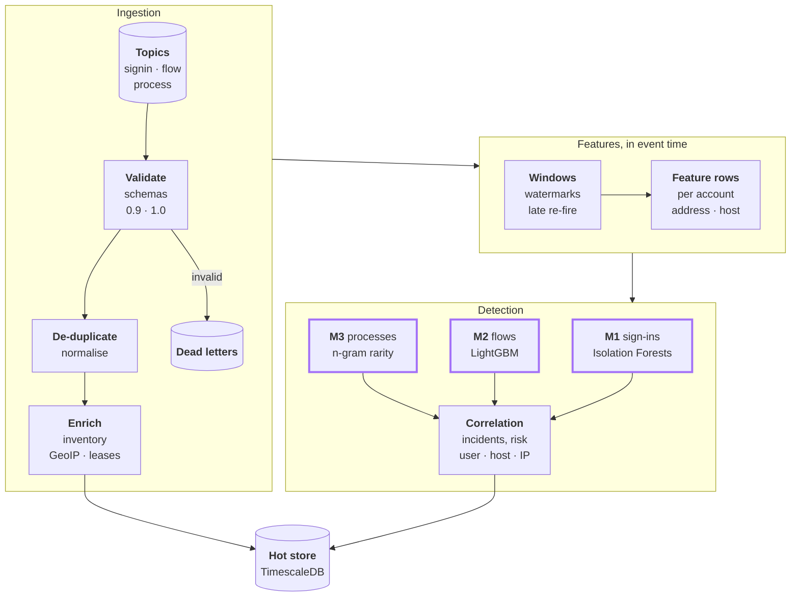

# Milestone 2: architecture and implementation plan

**Agentic SOC for a simulated enterprise** · Adi, Cristi, Dragos · AI4CI · 19 November 2026

The proposal is [RFC-0001](../rfc/0001-agentic-soc.md) (Milestone 1). This document covers Milestone 2: the system's architecture and the reasons for it, its data and AI modules, how models are trained and used, how the system is evaluated, and the plan up to the final presentation in week 14 (11–17 January 2027).

> [!NOTE]
> **Where the project stands.** The architecture below is implemented and runs end to end. The code is in this repository (commits of 13–15 November), CI runs the 182 unit tests and builds the console on every push, a recorded run is [live on GitHub Pages](https://chris91ss.github.io/ai4ci-agentic-soc/), and the first results are in [docs/evaluation](../evaluation/README.md).

**Contents:** [1. Problem and industrial context](#1-problem-and-industrial-context) · [2. Data sources](#2-data-sources) · [3. System architecture](#3-system-architecture)

## 1. Problem and industrial context

A security operations centre (SOC) protects a company whose identity provider, network and endpoints are connected systems, run by different teams and logged separately: who signs in from where, which hosts exchange how much data, and what runs on each host. An intrusion leaves weak traces in all three, minutes or hours apart, and rarely a conclusive one in any. Analysts receive thousands of alerts a day and ignore most of them, and breaches still take months to identify and contain ([RFC §1](../rfc/0001-agentic-soc.md#1-project-description)). The decision that matters is made per incident: is this an attack, and what should be contained now, without locking out the business?

The company is simulated. Example Corp has 200 employees, each with a workstation, in two offices in Cluj-Napoca and Bucharest, and 50 servers: domain controllers, file, database, application, ERP, mail, backup, build and jump hosts, and a DMZ with web servers, proxies and the VPN gateway. Staff sign in to the VPN and to SaaS applications through single sign-on. A seeded simulator stands in for the company: it emits its telemetry, hides one ATT&CK-mapped intrusion among benign activity, and applies the SOC's containment. A decision therefore has consequences (the attacker pivots or stalls), and every result has ground truth.

### Stakeholders

| Stakeholder | What they need | What the system gives them |
| --- | --- | --- |
| SOC analysts (tier 1 and 2) | Fewer, better-founded alerts, and evidence they can check | Incidents instead of alerts (81% fewer), each with the agent's verdict, its investigation and the evidence it cited; approve or reject high-impact actions; label verdicts |
| Incident responders, SOC lead | Containment before data leaves, and a record of what was done and why | Containment within minutes of detection; a hash-chained audit log of every decision, proposal, approval and execution |
| Employees and IT operations | Not to be locked out by mistake | False containment is the main cost metric; high-impact actions wait for an analyst; only an analyst may isolate core servers, and office and major providers' addresses cannot be blocked |
| Detection and ML engineers | To know when a model degrades, and to roll back | A drift monitor with alarms and retraining; a versioned model registry with promotion and rollback |
| CISO and compliance | Lower risk, without sending telemetry to third parties | A local LLM, so no log data leaves the company; every action traceable to its evidence |

### Decisions the system supports

1. **Is this window of activity anomalous?** Detectors M1–M3 score each entity's window of events, thousands an hour, and raise alerts.
2. **Which alerts belong together, and how risky are they?** Correlation links alerts by user, host and address into incidents with a risk score.
3. **Does this incident need investigating now?** The risk router logs it, queues it for the agent by priority, or hands it to a playbook when the agent is slow or down.
4. **Is it an attack, and what should be contained?** The triage agent returns a verdict, ATT&CK techniques, the evidence it relied on and up to three containment actions: revoke sessions, disable an account, isolate a host or block an address.
5. **May this action run?** The evidence verifier, the policy gate and, for high-impact actions, an analyst decide whether it executes, waits or is refused.
6. **Is M1 still valid?** The drift monitor raises an alarm and M1 is retrained.

The goal, set in the RFC, is to stop the intrusion before exfiltration with as few false containments as possible, and to show it end to end against a rule-based SOC and against detectors with playbooks.

## 2. Data sources

All operational data comes from the simulator, shaped like the telemetry a real SOC collects. Public datasets are used only offline, to calibrate it.

### Event streams

Volumes are from a 48-hour run (seed 201): the average an hour, and the busiest hour.

| Stream, topic | Produced by | One event is | Main fields | Volume per 48 h | Delivery |
| --- | --- | --- | --- | --- | --- |
| Sign-ins, `signin` | Identity provider: VPN, single sign-on, Windows logons | An authentication attempt | user, source address, application, destination host, logon type, protocol, outcome and failure reason, MFA, user agent, device, country and city, assigned VPN address | 10.4 thousand: 216 an hour, 610 at peak | Median delay 2 s; 1% late by 1–10 min; 0.3% duplicated; 35% of VPN sign-ins from an old appliance on schema 0.9 |
| Network flows, `flow` | Firewall and flow sensors | A connection record | source and destination address and port, protocol, duration, bytes and packets each way, firewall action, sensor | 281 thousand: 5,850 an hour, 13,300 at peak | Median 15 s; 2% late by 2–15 min; 1% duplicated; one sensor on schema 0.9 |
| Endpoint processes, `process` | EDR agents on the 250 hosts | A process launch | host, user, process and parent name, command line, image path, integrity level, pid and ppid | 125 thousand: 2,600 an hour, 6,900 at peak | Median 4 s; 3% late by 5–60 min; 0.5% duplicated; 3% of agents' clocks off by 30 s to 3 min |

Activity follows the working day and week: employees' activity at night is a few percent of its daytime peak and weekends carry about a fifth of a weekday's, while servers stay busy at night with batch jobs and backups; flow sizes are heavy-tailed. Malformed payloads, 0.03–0.05% of each stream or about 150 a run, go to a dead-letter topic. The JSON Schemas of every event version are in [docs/schemas](../schemas), generated from the Pydantic models with `soc schemas`.

### Context, labels and public data

- **Inventory**, slowly changing: 200 users with role, department, office and privileges, service accounts; 250 hosts with role, zone (corporate, data centre, DMZ), operating system and criticality 1–5; office egress netblocks; DHCP and VPN leases, which say which address a host or person had at a given time; GeoIP and network categories (ISP, hosting, anonymiser, cloud, CDN).
- **Ground truth**: the simulator labels every malicious event with its campaign stage and ATT&CK technique, and records the campaign's progress (stages reached, pivots, bytes exfiltrated, why it stalled) in each run's `truth.json`. Labels train M2 and score the evaluation; the agent never sees them.
- **Public datasets**, offline only and not redistributed: the [LANL multi-source events](https://csr.lanl.gov/data/cyber1/) (authentication, process and flow records) and the [RBA login dataset](https://doi.org/10.5281/zenodo.6782156). `soc calibrate` fits hourly and weekly activity profiles, flow size and duration distributions, and failure and new-country rates from them into [config/calibration](../../config/calibration). The current default is a hand-set prior shaped like LANL; fitting it on the real files is planned for weeks 9–10.
- **Analyst feedback**: verdicts entered in the console label the incident's alerts as true, false or benign positives.

### How new data enters the system

1. The simulator advances in 60-second ticks of simulated time. Each generator emits events with their event time, at rates that follow the calibrated daily and weekly profiles; the campaign's steps are interleaved with benign look-alikes (typos, travel, consumer VPNs, admin maintenance, nightly backups).
2. A delivery model gives each event an arrival time (a log-normal delay, stragglers, duplicates, producer clock skew), corrupts a few, and publishes them to their stream's topic, keyed by user, source address or host.
3. The ingestion consumer validates each payload against its schema version, sends failures to the dead-letter topic with an error code, upgrades 0.9 payloads, drops duplicates by event ID, normalises user and host names, and enriches the event from the inventory (person, role, zone, criticality, GeoIP, lease) before writing it to the hot store.
4. The feature pipeline puts each event into its event-time window: 15 minutes per account and per external source address for sign-ins, 15 minutes per source address for flows, and 10 minutes per host for processes. A window closes when the watermark, the latest arrival time minus 60 s (90 s for processes), passes its end. A late event re-opens its window and fires it again, for up to two hours.
5. In live mode the simulator publishes through Redpanda at a chosen speed, 60 or 120 times real time. Evaluation runs replay the same streams in process, in virtual time, faster than real time and deterministic under the seed.

## 3. System architecture

AI modules have a purple border in every figure.

### 3.1 Context and system boundary

*Figure 1. What we build and what it talks to.*

Inside the boundary is everything the project deploys: the broker, the SOC pipeline (ingestion, detection, correlation and response), the stores and the console. Outside are the simulated enterprise, the LLM runtime, the analyst and the public datasets. In a real deployment the company's identity provider, firewall and EDR would publish to the same topics and consume the `actions` topic, and nothing inside the boundary would change. Ollama runs on the same machine with open weights, so no telemetry leaves it. A second boundary runs through the data itself: every field that comes from the enterprise may be controlled by the attacker, and reaches the LLM only quoted as untrusted data.

### 3.2 Detection path

*Figure 2. From the topics to scored incidents.*

Ingestion turns three differently shaped, late and partly duplicated streams into clean, enriched events in the hot store. Entity resolution links the identifiers each stream uses for the same thing: an address is a host's DHCP or VPN lease at that moment, and an account is a person. Each closed window becomes a feature row for its detector, which scores it against a threshold and turns it into an alert with its top features and ATT&CK techniques. Correlation links alerts that share a user, host or address within six hours into incidents, and scores each incident from the strength of its evidence, how many independent detectors agree, how far along the kill chain it is, and what is at stake.

### 3.3 Response path

*Figure 3. From an incident to containment in the simulated enterprise.*

Incidents below risk 0.5 are only logged. The others wait in the agent's queue by priority, and are triaged again when their risk rises by 0.15 or a new tactic appears. The agent investigates through the MCP server only: it chooses which context and timelines to read and which detectors to run on which entity, then returns a decision. Its actions pass the evidence verifier (when enabled) and the policy gate, and so do the playbooks' actions. The action manager publishes executed actions on the `actions` topic, where the simulator applies them: a blocked address stops reaching the company, a revoked session must sign in again, a disabled account cannot, and an isolated host stops emitting flows. Every step is written to the hash-chained audit log, and every verdict is stored with the events, scores, baselines and tool calls behind it.

### 3.4 Interfaces

| Interface | Between | Protocol | Contract |
| --- | --- | --- | --- |
| `signin`, `flow`, `process` topics | simulator → ingestion | Kafka (Redpanda), JSON, keyed by user, source address or host | [Event schemas](../schemas): sign-in and flow 0.9 and 1.0, process 1.0 |
| Dead-letter topic | ingestion → operators | Kafka | Raw payload, error code and detail |
| `actions` topic | action manager → simulator | Kafka, JSON | [action.schema.json](../schemas/action.schema.json) |
| Detector service | pipeline and MCP tools → M1–M3 | REST: `POST /score/{M1,M2,M3}`, `GET /models` | Feature rows in; scores, thresholds and top features out |
| MCP server | agent → SOC tools | MCP, in process; stdio or streamable HTTP with `soc mcp` | 7 tools with JSON results; log text wrapped as `{"$untrusted": ...}` |
| LLM | agent → Ollama | HTTP `/api/chat` with tool calls | Decisions validated against [decision.schema.json](../schemas/decision.schema.json) |
| Console API | console → backend | REST and server-sent events | The `/api/...` endpoints listed in the [README](../../README.md#running-it) |

### 3.5 Storage

| Store | Technology | Holds | Written by | Read by |
| --- | --- | --- | --- | --- |
| Hot store | TimescaleDB; SQLite for tests and recorded runs | Normalised events, dead letters, alerts, incidents, decisions, tool calls, evidence, actions, feedback, audit log | Ingestion, pipeline, console API | MCP tools, console API, evaluation |
| Lake | Parquet, queried with DuckDB | The simulated weeks of the dataset plan, feature tables | `soc etl build`, `soc ingest --lake` | Training, analytics, deterministic replays |
| Model registry | Files: `models/<detector>/<version>/` and `current.json` | Fitted models, thresholds, validation results, drift references | `soc train`, `soc models --promote` | Pipeline, detector service |
| Run directory | `data/soc-runs/<run>/` | The run's store, summary, pipeline log and ground truth | `soc run` | Evaluation, console replay, `soc export` |

### 3.6 Deployment

Everything runs on one laptop; Docker is needed only for the live stack.

| Process | Started with | Port |
| --- | --- | --- |
| Redpanda and TimescaleDB | `make up` (Docker Compose) | 19092, 15432 |
| Simulator | `soc simulate --broker kafka://localhost:19092` | – |
| SOC pipeline with the console API | `soc pipeline --api-port 8000` | 8000 |
| Detector service (optional) | `soc serve-detectors` | 8001 |
| MCP server for other clients (optional) | `soc mcp --http` | 8002 |
| Ollama | `ollama serve` | 11434 |
| Console | `npm run dev`, or the static export on GitHub Pages | 3000 |

`soc demo` runs the simulator, the pipeline and the API in one process, and `soc run` runs a whole closed loop in virtual time for the evaluation.

### 3.7 Design decisions

| Decision | Instead of | Why |
| --- | --- | --- |
| A seeded simulator of the company | Recorded datasets only (LANL, CIC-IDS) | Containment must change what the attacker does next, which a recording cannot do; every event has ground truth; no personal data. Realism comes from calibration and hard negatives |
| A Kafka-compatible broker (Redpanda) | Function calls between components | The streams arrive independently, late and out of order, as in a real SOC; consumer groups and replays; Redpanda is a single binary that runs on a laptop |
| Event-time windows with watermarks | Processing-time windows | Delivery delays range from 2 seconds to an hour depending on the stream; results must not depend on arrival order |
| One specialised detector per stream | One model over all streams | Each stream has its own meaning and rate (27 flows per sign-in); small models are fast, explainable and retrained independently, as M1 is under drift |
| Correlation before the LLM | Sending alerts to the agent | An LLM needs seconds per step. Folding about 180 alerts a run into about 30 incidents, and sending only risk ≥ 0.5 to the agent, keeps it within its budget |
| A local open-weight LLM | A cloud LLM API | Telemetry is personal and security-sensitive; nothing leaves the machine; fixed weights make runs reproducible; no cost per call |
| MCP between the agent and its tools | Tools wired into the prompt | One typed interface; the agent decides which detector to query for which entity; other MCP clients can use the same server |
| Deterministic guardrails around the LLM | Trusting the model's output | Prompt injection and hallucinated evidence are documented failure modes of LLM agents ([RFC P5](../rfc/0001-agentic-soc.md#2-problem-definitions)); the policy gate, the verifier and the quoting are code that can be tested |
| Playbooks behind a circuit breaker | Waiting for the agent | The attack goes on while the agent is slow; scenario S2 measures the fallback |
| TimescaleDB hot store and a Parquet lake | One database | Operational queries (incidents, timelines, evidence) and analytics over weeks of training data have different shapes |
