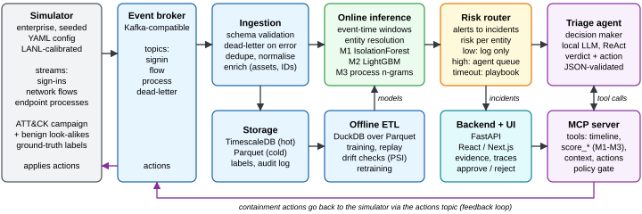

# RFC-0001: Agentic SOC for a Simulated Enterprise

**Authors:** Adi, Cristi, Dragos | **Course:** AI4CI | **Repository:** [github.com/Chris91ss/ai4ci-agentic-soc](https://github.com/Chris91ss/ai4ci-agentic-soc)

## 1. Project description

Security Operations Centers (SOCs) must decide quickly whether weak signals scattered across identity, network and endpoint telemetry form an attack, and how to contain it without disrupting the business. This does not scale: SOC teams receive on average 4,484 alerts per day and ignore 67% of them [1], and breaches still take 241 days to identify and contain at an average cost of USD 4.44M, while organisations that use security AI and automation extensively shorten this lifecycle by 80 days and save USD 1.9M [2].

We will build **Agentic SOC**, an AI-enabled security operations system for a simulated mid-size enterprise (about 200 users and 250 hosts). A reproducible simulator emits three independent, asynchronous streams with different business meanings: **sign-ins** (who authenticates, from where), **network flows** (which hosts exchange how much data) and **endpoint processes** (what runs on each host), and hides a multi-stage intrusion among benign activity. ML detectors score each stream online, a correlation layer links their alerts per user, host and IP into incidents, and a **local-LLM triage agent acts as the decision maker**: it investigates escalated incidents by calling the detectors and context tools through an MCP server, decides a verdict and a containment action (revoke sessions, disable account, isolate host, block IP), and the action is applied back to the simulator, closing the loop. **Goal:** stop the intrusion before data exfiltration with as few false containments as possible, demonstrated end-to-end against rule-only and ML-only baselines.

## 2. Problem definitions

- **P1. Realistic, reproducible telemetry.** Three generators with their own rates, clocks and delivery delays must reproduce diurnal and weekly seasonality, heavy-tailed flow sizes [5] and jittered C2 beacons, calibrated on public data [3, 4] and deterministic under a seed.
- **P2. Correlating asynchronous streams.** Events arrive late, out of order or duplicated, and each stream identifies entities differently; correlation needs event-time windows with watermarks [6] and entity resolution that links users, hosts and IPs.
- **P3. Rare attacks, costly false positives.** Malicious events are far below 1% of traffic, so even accurate detectors produce mostly false alarms (base-rate fallacy [7]); evaluation must avoid temporal leakage, data snooping and simulator artefacts [8, 9].
- **P4. Latency budget.** Detectors must keep up with thousands of events per second, whereas a local LLM needs seconds per step; routing must decide what deserves the agent's attention and what happens when it is slow or down.
- **P5. Trustworthy autonomous actions.** Tool-using LLM agents miss attacks (all five agentic triage strategies in [10] missed at least 40% of attack-related alerts), may hallucinate tool calls, and read attacker-controlled strings (command lines, user agents) that enable indirect prompt injection [11]; high-impact containment needs guardrails, approval and verifiable evidence.
- **P6. Closed loop and non-stationarity.** Containment changes the data the models see next, benign behaviour drifts (e.g., a shift to remote work) and load can spike; the system must detect drift, retrain offline and degrade gracefully.

## 3. State of the art

| Approach | Representative work | Pros | Cons |
|--------------|---------------------------|----------------------|------------------------------------|
| SIEM rules + SOAR playbooks | Microsoft Sentinel analytics rules and playbooks [12], Splunk ES, Sigma, Cortex XSOAR | Deterministic, explainable and auditable; mature integrations | Static logic misses novel attacks; heavy rule and playbook maintenance; a major source of alert fatigue [1] |
| ML / UEBA anomaly detection | Sentinel UEBA [12], Exabeam; Isolation Forest [13], Kitsune [14], DeepLog [15] | Detects unknown and low-and-slow behaviour without signatures | False positives dominate at low base rates [7]; each model sees a single data source; degrades under drift [9] |
| Cross-source and provenance correlation (XDR) | Defender XDR incidents; NoDoze [16] (86% fewer false alarms); Kairos [17] | Reconstructs multi-stage attack stories; cuts alert volume | Heavy host instrumentation; academic systems evaluated offline and stop at triage; commercial engines are opaque |
| LLM copilots and SOC agents | Security Copilot RCT [18] (experienced analysts 22% faster, 7% more accurate); Charlotte AI, Cortex XSIAM; ExCyTIn-Bench [19]; ALERT-BENCH [10] | Reasons over heterogeneous evidence; uses tools; handles novel cases | Mostly vendor-reported metrics; best benchmark reward only 0.606 [19]; missed attacks and hallucinations [10]; prompt injection [11]; cloud data-privacy concerns; rarely evaluated in a closed loop |
| Autonomous cyber-defence simulators | CybORG / CAGE challenges [20], CyberBattleSim [21] | Closed loop: defender actions change the environment; reproducible benchmarks | Abstract network state; no realistic telemetry, ingestion or detection pipeline |

Agent-tool integration is converging on the Model Context Protocol (MCP) [22]; Microsoft Sentinel and Google Security Operations already ship MCP servers [23]. Yet we found no open system that combines (i) realistic multi-stream asynchronous telemetry, (ii) specialised per-stream detectors, (iii) an MCP-orchestrated *local* LLM agent with guarded containment and (iv) closed-loop, end-to-end evaluation under drift and load. Agentic SOC targets this gap.

## 4. Solution

**Simulator.** A Python simulator, driven by a YAML config and a seed, models users, hosts, roles, schedules and network zones. Benign arrival rates, diurnal profiles and size distributions are fitted on the LANL multi-source dataset [3], with login attributes from [4]. One ATT&CK-mapped campaign is injected (password spraying, use of a valid account, credential dumping, lateral movement, then C2 beaconing and exfiltration) among benign look-alikes such as typos, travel or VPN logins, admin remote sessions and nightly backups. Ground-truth labels are stored, and a control interface applies containment actions to the simulated environment.

**Ingestion, storage and offline ETL.** Each stream is a topic on a Kafka-compatible broker. An ingestion service validates events against versioned Pydantic schemas (OCSF-inspired), sends invalid ones to a dead-letter topic, de-duplicates, normalises and enriches them (asset and identity inventory), and writes them to PostgreSQL/TimescaleDB (hot) and Parquet (cold). Offline ETL in DuckDB builds time-split training sets, analytics and deterministic replays.

**Online inference (downstream models).** Per-entity event-time windows feed three detector services: **M1** sign-in anomaly (Isolation Forest), **M2** flow classifier (LightGBM with beacon-periodicity features) and **M3** endpoint process-sequence rarity (n-grams over parent-child process pairs). A correlation engine groups their alerts by entity and time into incidents with a risk score.

**Decision-making agent and its infrastructure.** A local open-weight LLM (e.g., gpt-oss-20b or Qwen3-30B-A3B, mixture-of-experts models with about 3.5B active parameters that fit a 64 GB laptop without a discrete GPU) runs a ReAct loop. The agent reaches every capability through **MCP tools**, so it decides which downstream models to query for each incident: `get_incident`, `get_entity_timeline`, `get_asset_context` and `propose_action`, plus the scoring tools `score_signins`, `score_flows` and `score_processes`, which call M1-M3 over REST. It returns a JSON-schema-validated decision: verdict, ATT&CK techniques, evidence, action and confidence.

**Routing and guardrails.** A risk router only logs low-risk incidents and queues the others for the agent by priority; when the agent times out or the queue saturates, a deterministic playbook decides instead (circuit breaker). Actions come from an allow-list with impact levels: low-impact ones (revoke sessions, block an external IP) execute automatically, high-impact ones (disable account, isolate host) require analyst approval (auto-approved in unattended evaluation runs). Dismissals must cite evidence, log fields reach the LLM only as quoted data, and every step is audited.

**Backend, UI and feedback loop.** A FastAPI backend serves a React/Next.js SOC console: stream health, incident queue, entity timelines, the agent's tool trace, approve/reject controls and live metrics. Executed actions are published back to the simulator, where disabled accounts can no longer sign in, isolated hosts stop emitting flows and the campaign stalls or pivots.

**Evidence and verification.** Every verdict is stored with the data behind it: the triggering events, detector scores with top contributing features, the entity's baseline (e.g., usual sign-in hours, traffic volume) and the agent's tool calls, all cited by ID in its explanation. Analysts can filter this evidence by entity, stream, detector and time window, so a suspected false positive can be verified, not taken on trust; their verdicts feed retraining and per-detector false-positive statistics.

**Evaluation.** *Model level:* PR-AUC, recall at 1% FPR and detection delay for each detector on time-ordered splits [9]; verdict F1, action correctness, invalid tool-call rate and latency for the agent. *End to end* (at least 10 seeded runs): mean time to detect and to contain, share of campaigns stopped before exfiltration, false containments and alert-to-incident reduction, compared with (a) rules and playbooks only and (b) detectors with static thresholds and no agent. *Scenarios:* **S1 (drift):** a mid-run shift to remote work changes sign-in locations and times; PSI/KS monitors raise an alarm, M1 is retrained offline and recovery time is measured. **S2 (high load):** a 10x event burst; we measure consumer lag and p95 latency while the router sheds load and falls back to playbooks.

**Scope.** One simulated organisation, one attack campaign with benign look-alikes and scenarios S1-S2. Real malware, packet capture and production hardening are out of scope; a verifier agent and deep detectors (e.g., DeepLog [15]) are stretch goals.

## References

1. Vectra AI. [*2023 State of Threat Detection*](https://www.vectra.ai/resources/2023-state-of-threat-detection) (survey of 2,000 SOC analysts). 2023.
2. IBM Security, Ponemon Institute. [*Cost of a Data Breach Report 2025*](https://newsroom.ibm.com/2025-07-30-ibm-report-13-of-organizations-reported-breaches-of-ai-models-or-applications,-97-of-which-reported-lacking-proper-ai-access-controls). Jul. 2025.
3. A. D. Kent. [*Comprehensive, Multi-Source Cyber-Security Events*](https://csr.lanl.gov/data/cyber1/). Los Alamos National Laboratory, 2015. doi:10.17021/1179829.
4. S. Wiefling et al. [*Login Data Set for Risk-Based Authentication*](https://doi.org/10.5281/zenodo.6782156). Zenodo, 2022.
5. W. E. Leland, M. S. Taqqu, W. Willinger, D. V. Wilson. [On the self-similar nature of Ethernet traffic](https://doi.org/10.1109/90.282603). *IEEE/ACM Trans. Networking* 2(1), 1994.
6. T. Akidau et al. [The Dataflow Model: a practical approach to balancing correctness, latency, and cost in massive-scale, unbounded, out-of-order data processing](https://www.vldb.org/pvldb/vol8/p1792-Akidau.pdf). *PVLDB* 8(12), 2015.
7. S. Axelsson. [The base-rate fallacy and the difficulty of intrusion detection](https://doi.org/10.1145/357830.357849). *ACM TISSEC* 3(3), 2000.
8. D. Arp et al. [Dos and don'ts of machine learning in computer security](https://arxiv.org/abs/2010.09470). *USENIX Security*, 2022.
9. F. Pendlebury et al. [TESSERACT: eliminating experimental bias in malware classification across space and time](https://arxiv.org/abs/1807.07838). *USENIX Security*, 2019.
10. S. A. Tsegai et al. [From investigation failures to reliable SOC agents: understanding and improving LLM-based alert triage](https://arxiv.org/abs/2610.10608). arXiv:2610.10608, 2026.
11. K. Greshake et al. [Not what you've signed up for: compromising real-world LLM-integrated applications with indirect prompt injection](https://doi.org/10.1145/3605764.3623985). *ACM AISec*, 2023.
12. Microsoft. [Microsoft Sentinel documentation: threat detection, playbooks and UEBA](https://learn.microsoft.com/azure/sentinel/threat-detection). Microsoft Learn, 2026.
13. F. T. Liu, K. M. Ting, Z.-H. Zhou. [Isolation Forest](https://cs.nju.edu.cn/zhouzh/zhouzh.files/publication/icdm08b.pdf). *IEEE ICDM*, 2008.
14. Y. Mirsky, T. Doitshman, Y. Elovici, A. Shabtai. [Kitsune: an ensemble of autoencoders for online network intrusion detection](https://arxiv.org/abs/1802.09089). *NDSS*, 2018.
15. M. Du, F. Li, G. Zheng, V. Srikumar. [DeepLog: anomaly detection and diagnosis from system logs through deep learning](https://doi.org/10.1145/3133956.3134015). *ACM CCS*, 2017.
16. W. U. Hassan et al. [NoDoze: combatting threat alert fatigue with automated provenance triage](https://www.ndss-symposium.org/ndss-paper/nodoze-combatting-threat-alert-fatigue-with-automated-provenance-triage/). *NDSS*, 2019.
17. Z. Cheng et al. [Kairos: practical intrusion detection and investigation using whole-system provenance](https://arxiv.org/abs/2308.05034). *IEEE S&P*, 2024.
18. Microsoft. [Copilot for Security general availability: randomized controlled trial results](https://www.microsoft.com/en-us/security/blog/2024/03/13/microsoft-copilot-for-security-is-generally-available-on-april-1-2024-with-new-capabilities/). Microsoft Security Blog, Mar. 2024.
19. Y. Wu et al. [ExCyTIn-Bench: evaluating LLM agents on cyber threat investigation](https://arxiv.org/abs/2507.14201). arXiv:2507.14201, 2025.
20. M. Standen et al. [CybORG: a gym for the development of autonomous cyber agents](https://arxiv.org/abs/2108.09118). *IJCAI-21 ACD Workshop*, 2021.
21. Microsoft. [CyberBattleSim](https://github.com/microsoft/CyberBattleSim). GitHub, 2021.
22. Model Context Protocol. [Specification, revision 2026-07-28](https://modelcontextprotocol.io/specification). 2026.
23. Microsoft. [Microsoft Sentinel MCP server](https://learn.microsoft.com/azure/sentinel/datalake/sentinel-mcp-get-started), 2026; Google. [mcp-security](https://github.com/google/mcp-security), 2026.

